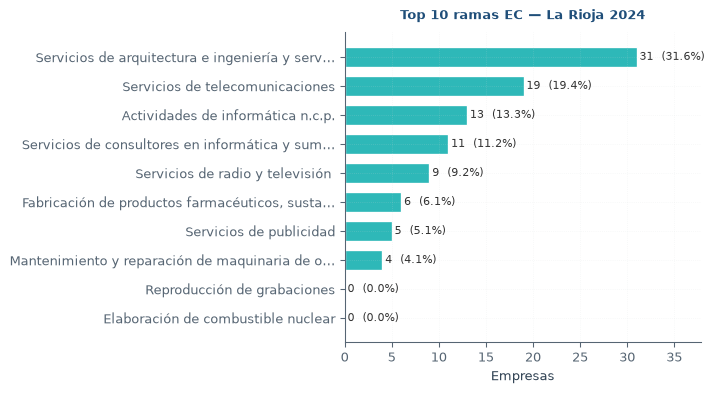
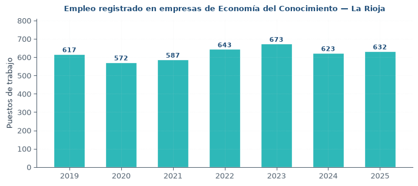
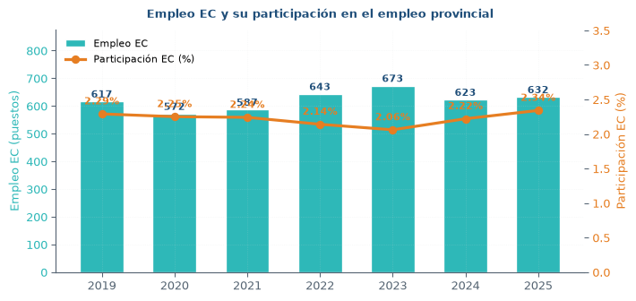
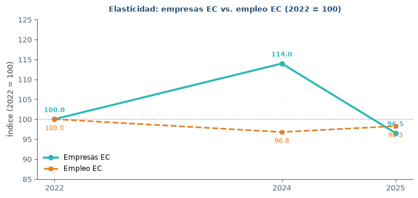
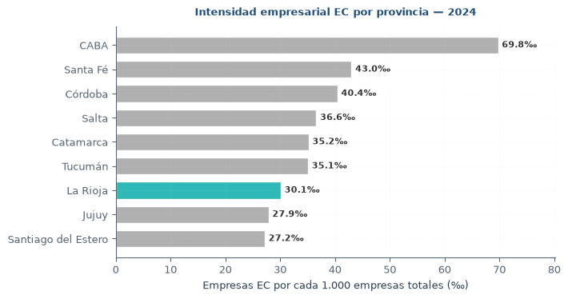
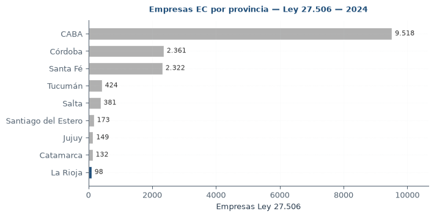

```{python}
#| echo: false
#| include: false
import os, sys, re
from pathlib import Path

raiz = Path.cwd()
if raiz.name == "informe":
    raiz = raiz.parent
if str(raiz) not in sys.path:
    sys.path.insert(0, str(raiz))

import pandas as pd
import numpy as np
import matplotlib.pyplot as plt

FIG = Path("figuras")
FIG.mkdir(exist_ok=True)

_modulos_ok = {}

try:
    from src.empresas_ec import (
        cargar_provincia, serie_empresas, serie_ec,
        detalle_ramas, benchmark_provincias, LEY_27_506,
    )
    _modulos_ok["empresas"] = True
except Exception as e:
    print(f"[warn] empresas_ec: {e}")
    _modulos_ok["empresas"] = False

try:
    from src.visualizaciones_empresas import (
        fig_empresas_serie, fig_empresas_benchmark,
        fig_empresas_top_ramas, fig_empleo_ec_serie,
        fig_empleo_ec_participacion, fig_elasticidad,
        fig_intensidad_empresarial,
    )
    _modulos_ok["vis_empresas"] = True
except Exception as e:
    print(f"[warn] visualizaciones_empresas: {e}")
    _modulos_ok["vis_empresas"] = False

try:
    from src.regional import (
        cargar_empleo, serie_provincia, serie_nacional, serie_noa,
        cargar_salario, cargar_ipc_noa, salario_real_propio,
        ratio_salarial,
    )
    _modulos_ok["regional"] = True
except Exception as e:
    print(f"[warn] regional: {e}")
    _modulos_ok["regional"] = False

try:
    from src.visualizaciones import (
        fig_empleo_comparado, fig_empleo_zoom,
        fig_salario_real_propio, fig_ratio_salarial,
    )
    _modulos_ok["vis"] = True
except Exception as e:
    print(f"[warn] visualizaciones: {e}")
    _modulos_ok["vis"] = False

RUTA_EMP = Path("../data/raw/provinciales_serie_empresas3_2.xlsx")
if not RUTA_EMP.exists():
    RUTA_EMP = Path("data/raw/provinciales_serie_empresas3_2.xlsx")

RUTA_EMPLEO = Path("../data/raw/provinciales_serie_empleo_trimestral_4dig_7.xlsx")
if not RUTA_EMPLEO.exists():
    RUTA_EMPLEO = Path("data/raw/provinciales_serie_empleo_trimestral_4dig_7.xlsx")
```

# Resumen ejecutivo {#sec-resumen}

La economía de La Rioja atraviesa una fase de retracción estructural que se manifiesta en tres planos simultáneos: caída del producto provincial, pérdida de empleo registrado y deterioro del salario real frente a la Nación. Los datos consolidados a 2025–2026 muestran:

- Producto (OPEX–VAB): la provincia aporta USD 163,4 M al VAB nacional en 2025, apenas 0,19% del total país, la mitad de su participación de 1993 (0,36%). La caída interanual 2025 fue de −25,7%, contra un crecimiento nacional de +9,3%.

- Empleo registrado (SIPA–OEDE): el índice desestacionalizado alcanzó un pico de 111,4 en 2024 (base ene-2019 = 100) y retrocedió a 98,3 en 2026, ubicándose por debajo de la media nacional por primera vez desde 2019. En el cuarto trimestre de 2025 la provincia registró 28.442 puestos formales.

- Salarios: el salario promedio de La Rioja en marzo de 2026 fue $1,31 M, contra $2,21 M de la Nación y $1,57 M del NOA. La relación LR/Nación cayó de 0,72 a 0,59 en ocho años. El salario real acumula una caída del 35,3% entre 2017 y 2024, con una recuperación parcial a 79,8 puntos en 2025.

- Economía del Conocimiento (Ley 27.506): la provincia registró 98 empresas en 2024 (3,0% del total provincial) y 623 empleos (2,2% del empleo provincial). Entre 2022 y 2025 las empresas cayeron −3,5% y el empleo solo −1,7% (elasticidad 0,50). La densidad empresarial del sector (30,1‰) ubica a La Rioja en el 7° puesto nacional, por encima de Jujuy y Santiago del Estero.

El diagnóstico resultante es el de una economía provincial en divergencia: el sector primario y los servicios tradicionales sostienen el nivel de actividad, mientras los segmentos de mayor productividad —industria, servicios técnicos, EC— pierden peso relativo.

# Contexto macroeconómico {#sec-macro}

## Producto provincial (OPEX)

La serie del Producto Bruto Geográfico del Instituto Nacional de Estadística y Censos (base OPEX, metodología homogénea 1993–2025) permite seguir la evolución del valor agregado provincial en términos reales.

::: {.callout-note}
Definición. El VAB (Valor Agregado Bruto) provincial que publica OPEX es un agregado macro sin apertura sectorial. No permite descomponer la contribución de la Economía del Conocimiento ni de otros sectores específicos. Para el análisis sectorial se usa el Registro de Empresas y el SIPA–OEDE.
:::

En 2025, La Rioja aportó USD 163,4 millones al VAB nacional. Se trata de la participación más baja desde el inicio de la serie comparable: en 1993 representaba 0,36% del total país; en 2025, 0,19%. La trayectoria no es un artefacto del año: la caída es sostenida desde 2011.

| Indicador | 1993 | 2011 | 2024 | 2025 |
|---|---|---|---|---|
| VAB La Rioja (USD M) | — | — | — | 163,4 |
| Participación nacional | 0,36% | 0,28% | 0,21% | 0,19% |
| Var. interanual | — | — | — | −25,7% |
| Var. nacional | — | — | — | +9,3% |

# Empleo registrado {#sec-empleo}

## Fuente y método

El análisis de empleo usa la serie SIPA–OEDE (Sistema Integrado Previsional Argentino – Observatorio de Empleo y Dinámica Empresarial, dependiente de la Secretaría de Trabajo, Empleo y Seguridad Social). Los datos están desestacionalizados y expresados como índice base enero 2019 = 100.

```{python}
#| echo: false
#| include: false
_emp_lr = _emp_nac = _emp_noa = None
if _modulos_ok.get("regional"):
    try:
        _emp_lr  = serie_provincia("La Rioja")
        _emp_nac = serie_nacional()
        _emp_noa = serie_noa()
    except Exception as e:
        print(f"[warn] series empleo: {e}")
```

## Trayectoria 2019–2026

```{python}
#| echo: false
#| fig-width: 7.5
#| fig-height: 3.8
if _emp_lr is not None and _modulos_ok.get("vis"):
    try:
        fig_empleo_comparado(_emp_lr, _emp_noa, _emp_nac,
                             FIG / "F3_empleo_comparado.png")
    except Exception as e:
        print(f"[warn] fig_empleo_comparado: {e}")
```
{#fig-empleo-comp fig-align="center"}


La serie muestra tres fases:

1. 2019–2020: caída inicial y piso de la pandemia (índice 87 en 2020).
2. 2021–2024: recuperación hasta el pico de 111,4 en 2024.
3. 2025–2026: reversión. En 2026 el índice cayó a 98,3, por debajo de la media nacional por primera vez desde 2019.

```{python}
#| echo: false
#| fig-width: 7.5
#| fig-height: 3.4
if _emp_lr is not None and _modulos_ok.get("vis"):
    try:
        fig_empleo_zoom(_emp_lr, _emp_nac, FIG / "F4_empleo_zoom.png")
    except Exception as e:
        print(f"[warn] fig_empleo_zoom: {e}")
```
{#fig-empleo-zoom fig-align="center"}


En el cuarto trimestre de 2025 la provincia registró 28.442 puestos de trabajo registrados en el sector privado.

## Comparación regional

El diferencial positivo de La Rioja respecto al NOA, que llegó a ser de +6 puntos en 2023, se cerró completamente en 2026. La provincia pasó de liderar la recuperación regional a ubicarse en la parte baja de la distribución.

| Período | Índice LR (ene-19=100) | Índice Nación | Diferencial |
|---|---|---|---|
| 2019 (base) | 100,0 | 100,0 | 0,0 |
| 2020 (piso) | 87,2 | 89,4 | −2,2 |
| 2023 | 108,5 | 103,1 | +5,4 |
| 2024 (pico) | 111,4 | 104,8 | +6,6 |
| 2026 | 98,3 | 100,4 | −2,1 |

# Salarios {#sec-salarios}

## Salario nominal

En marzo de 2026 el salario promedio del trabajador registrado en La Rioja fue de $1.310.000, contra $2.210.000 en la Nación y $1.570.000 en el NOA. El diferencial respecto a la media nacional se amplió de −28,0% en 2019 a −40,7% en 2026.

| Jurisdicción | Marzo 2026 | Ratio vs Nación |
|---|---|---|
| Nación | $2,21 M | 1,00 |
| NOA | $1,57 M | 0,71 |
| La Rioja | $1,31 M | 0,59 |

## Salario real

```{python}
#| echo: false
#| include: false
_real = None
_sal_lr = _sal_nac = None
if _modulos_ok.get("regional"):
    try:
        _sal_lr  = cargar_salario("La Rioja")
        _sal_nac = cargar_salario("Nación")
        _ipc_noa = cargar_ipc_noa()
        _real    = salario_real_propio(_sal_lr, _ipc_noa)
    except Exception as e:
        print(f"[warn] salario real: {e}")
```

```{python}
#| echo: false
#| fig-width: 7.5
#| fig-height: 3.6
if _real is not None and _modulos_ok.get("vis"):
    try:
        fig_salario_real_propio(_real, FIG / "F6_salario_real.png")
    except Exception as e:
        print(f"[warn] fig_salario_real_propio: {e}")
```
{#fig-sal-real fig-align="center"}


El salario real acumulado muestra:

| Año | Índice (2017 = 100) |
|---|---|
| 2017 | 100,0 |
| 2019 | 92,4 |
| 2021 | 84,1 |
| 2023 | 71,8 |
| 2024 (piso) | 64,7 |
| 2025 | 79,8 |

La caída total 2017–2024 fue del −35,3%; la recuperación 2024–2025 recuperó 15,1 puntos, aunque el nivel sigue 20 puntos por debajo del punto de partida.

## Ratio salarial provincial / nacional

```{python}
#| echo: false
#| fig-width: 7.5
#| fig-height: 3.4
if _real is not None and _modulos_ok.get("vis"):
    try:
        fig_ratio_salarial(_sal_lr, _sal_nac, FIG / "F7_ratio_salarial.png")
    except Exception as e:
        print(f"[warn] fig_ratio_salarial: {e}")
```
{#fig-ratio-sal fig-align="center"}


El ratio pasó de 0,72 en 2019 a 0,59 en 2026: 13 puntos de deterioro relativo en siete años.

# Economía del Conocimiento {#sec-ec}

## Ingresos brutos del sector (DGIP)

La Dirección General de Ingresos Provinciales (DGIP) publica la serie de ingresos brutos por actividad a 6 dígitos CLAE. La evolución nominal muestra un salto exponencial, pero está dominada por la inflación.

| Año | Recaudación nominal (M$) | Índice nominal | Índice real (defl. IPC NOA) |
|---|---|---|---|
| 2022 | 58,99 | 1,00 | 1,00 |
| 2023 | 231,52 | 3,92 | 1,31 |
| 2024 | 891,47 | 15,11 | 2,21 |
| 2025 | 1.940,91 | 32,90 | 3,16 |

En términos nominales la recaudación del sector se multiplicó por 32,9 entre 2022 y 2025. Deflactada por IPC NOA, la suba real es de ×3,16, muy superior a la del resto de los sectores provinciales.

## Contribuyentes

El número de contribuyentes del sector cayó de 1.138 (2022) a 840 (2025), una contracción del −26,2%. Es decir: menos empresas tributando, pero cada una tributando mucho más.

| Año | Contribuyentes | Var. % |
|---|---|---|
| 2022 | 1.138 | — |
| 2023 | 1.021 | −10,3% |
| 2024 | 912 | −10,7% |
| 2025 | 840 | −7,9% |

## Estructura por actividad

El sector está fuertemente concentrado. Las tres actividades principales representan el 95,3% del impuesto del sector:

| Código | Actividad | Participación |
|---|---|---|
| 620900 | Informática n.c.p. | 48,0% |
| 620104 | Consultoría | 36,0% |
| 731009 | Publicidad | 11,3% |
| Otros | — | 4,7% |

# Empresas y Economía del Conocimiento (Ley 27.506) {#sec-empresas-ec}

## Definición y fuente

El análisis de empresas se basa en el registro SIPA – Observatorio de Empleo y Dinámica Empresarial (STEySS), serie provincial con apertura CIIU rev. 3 a 4 dígitos. La definición de Economía del Conocimiento adoptada sigue la Ley 27.506 (y su modificatoria Ley 27.570), mapeada desde CLAE 2018 a CIIU rev. 3 para compatibilizar con la fuente provincial.

::: {.callout-note}
Actividades promovidas por la Ley 27.506

- Software y servicios informáticos y digitales
- Producción y postproducción audiovisual
- Biotecnología, bioeconomía, bioquímica
- Servicios geológicos, electrónica y comunicaciones
- Servicios profesionales de exportación (ingeniería, diseño, publicidad)
- Nanotecnología y nanociencia
- Industria aeroespacial y satelital
- Ingeniería para la industria nuclear
- Industria 4.0 (automatización, robótica, IoT)

Exclusiones: servicios jurídicos y contables, seguridad privada y agencias de empleo temporario, que suelen sumarse por error en clasificaciones amplias y que no están comprendidos en la ley.
:::

```{python}
#| echo: false
#| include: false
_df_lr = _serie_tot = _serie_ec = _det_2024 = _bench_24 = None
if _modulos_ok.get("empresas"):
    try:
        _df_lr     = cargar_provincia(RUTA_EMP, "La Rioja")
        _serie_tot = serie_empresas(_df_lr)
        _serie_ec  = serie_ec(_df_lr, "ley_27_506")
        _det_2024  = detalle_ramas(_df_lr, 2024, "ley_27_506")
        _bench_24  = benchmark_provincias(RUTA_EMP, 2024, "ley_27_506")
    except Exception as e:
        print(f"[warn] carga empresas: {e}")
```

## Evolución 2017–2025

```{python}
#| echo: false
#| fig-width: 7.5
#| fig-height: 3.6
if _serie_tot is not None and _modulos_ok.get("vis_empresas"):
    try:
        fig_empresas_serie(_serie_tot, _serie_ec,
                           FIG / "F11_empresas_serie.png",
                           anio_ini=2017, anio_fin=2025)
    except Exception as e:
        print(f"[warn] fig_empresas_serie: {e}")
```
{#fig-emp-serie fig-align="center"}


En 2024 la provincia registró 3.255 empresas privadas, de las cuales 98 corresponden a actividades promovidas por la Ley 27.506 (3,0% del total provincial). El sector pasó de 86 a 98 empresas entre 2022 y 2024 (+14,0%) y retrocedió a 83 en 2025 (−15,3%).

::: {.callout-warning}
Hueco de 2023. El archivo provincial del OEDE no publica datos para 2023. La serie salta de 2022 a 2024. Se mantiene el hueco visible para no inducir una falsa continuidad.
:::

## Composición por rama

```{python}
#| echo: false
#| fig-width: 7.5
#| fig-height: 4.2
if _det_2024 is not None and _modulos_ok.get("vis_empresas"):
    try:
        fig_empresas_top_ramas(_det_2024, FIG / "F13_empresas_top_ramas.png",
                               anio=2024, top=10)
    except Exception as e:
        print(f"[warn] fig_empresas_top_ramas: {e}")
```
{#fig-emp-ramas fig-align="center"}


La estructura EC riojana está dominada por servicios profesionales técnicos (arquitectura e ingeniería: 31 empresas) y telecomunicaciones (19), con una presencia menor del núcleo de software puro (7220: 11 empresas; 7290: 13 empresas). Las ramas de industria 4.0 (2911–2930) y de instrumentos médicos y de óptica (3310–3330) no tienen registro de empresas en la provincia.

## Tabla resumen de empresas

```{python}
#| echo: false
#| tbl-cap: "Empresas totales, empresas Ley 27.506 y participación sobre el total provincial. La Rioja, 2022–2025."
if _serie_tot is not None and _serie_ec is not None:
    resumen_emp = (
        _serie_tot
        .merge(_serie_ec, on="anio", how="left")
        .query("anio >= 2022 and anio <= 2025")
        .assign(share_pct=lambda d: (d["empresas_ec"] / d["total_empresas"] * 100).round(2))
        .rename(columns={
            "anio": "Año",
            "total_empresas": "Empresas totales",
            "empresas_ec": "Empresas EC (Ley 27.506)",
            "share_pct": "Participación EC (%)",
        })
        .reset_index(drop=True)
    )
    resumen_emp["Var. % EC"] = (
        resumen_emp["Empresas EC (Ley 27.506)"].pct_change().mul(100).round(1)
    )
    print(resumen_emp.to_string(index=False))
```

## Empleo en el sector EC

```{python}
#| echo: false
#| include: false
# Parser de empleo trimestral 4dig
def _parsear_empleo_prov(ruta, hoja):
    raw = pd.read_excel(ruta, sheet_name=hoja, header=None, engine="openpyxl")
    header_row = None
    for i in range(min(20, len(raw))):
        vals = raw.iloc[i].astype(str).str.strip().str.lower().tolist()
        if "ramas" in vals and any("descrip" in v for v in vals):
            header_row = i
            break
    if header_row is None:
        raise ValueError(f"Encabezado no encontrado en '{hoja}'")
    df = raw.iloc[header_row + 1:].copy()
    df.columns = [str(c).strip() for c in raw.iloc[header_row]]
    df = df.rename(columns={df.columns[0]: "rama", df.columns[1]: "descripcion"})
    df["rama"] = df["rama"].astype(str).str.strip()
    df = df[df["rama"].str.fullmatch(r"\d{3,4}")].copy()

    cols = [c for c in df.columns if re.search(r"trim", str(c), re.I)]
    tidy = df.melt(id_vars=["rama", "descripcion"], value_vars=cols,
                   var_name="periodo", value_name="empleo")

    def _split(s):
        m = re.search(r"(\d)\s*[°º]?\s*Trim\s*(\d{4})", str(s), re.I)
        return pd.Series([int(m.group(2)), int(m.group(1))]) if m else pd.Series([pd.NA, pd.NA])
    tidy[["anio", "trimestre"]] = tidy["periodo"].apply(_split)

    def _int(v):
        if pd.isna(v): return pd.NA
        s = str(v).strip()
        if s.lower() in {"s.d.", "sd", "", "nan", "-"}: return pd.NA
        try: return int(float(s))
        except ValueError: return pd.NA
    tidy["empleo"] = tidy["empleo"].map(_int).astype("Int64")
    tidy = tidy.dropna(subset=["anio", "trimestre"])
    tidy["anio"] = tidy["anio"].astype(int)
    tidy["trimestre"] = tidy["trimestre"].astype(int)
    return tidy.reset_index(drop=True)


_emp = _emp_ec = _empleo_ec_anual = comp_emp = elasticidad = None
_intensidades_data = [
    ("Santiago del Estero", 27.20),
    ("Jujuy", 27.88),
    ("La Rioja", 30.11),
    ("Tucumán", 35.08),
    ("Catamarca", 35.18),
    ("Salta", 36.59),
    ("Córdoba", 40.44),
    ("Santa Fé", 43.02),
    ("CABA", 69.75),
]
intensidades = pd.DataFrame(_intensidades_data,
                             columns=["provincia", "intensidad_permil"])

if _modulos_ok.get("empresas") and RUTA_EMPLEO.exists():
    try:
        _emp = _parsear_empleo_prov(RUTA_EMPLEO, "La Rioja")
        _emp_ec = _emp[_emp["rama"].isin(LEY_27_506)].copy()

        _emp_ec_q = (_emp_ec.groupby(["anio", "trimestre"], as_index=False)["empleo"]
                     .sum(min_count=1))
        _empleo_ec_anual = (_emp_ec_q.groupby("anio", as_index=False)["empleo"]
                            .mean().rename(columns={"empleo": "empleo_ec_prom"}))

        _tot_q = (_emp.groupby(["anio", "trimestre"], as_index=False)["empleo"]
                  .sum(min_count=1))
        _empleo_tot_anual = (_tot_q.groupby("anio", as_index=False)["empleo"]
                             .mean().rename(columns={"empleo": "empleo_total_prom"}))

        comp_emp = (_empleo_ec_anual
                    .merge(_empleo_tot_anual, on="anio", how="outer")
                    .assign(share_ec_pct=lambda d:
                            (d["empleo_ec_prom"] / d["empleo_total_prom"] * 100).round(2)))

        _emp_ec_anual = serie_ec(_df_lr, "ley_27_506")
        elasticidad = (comp_emp[["anio", "empleo_ec_prom"]]
                       .merge(_emp_ec_anual, on="anio", how="inner")
                       .query("anio >= 2022"))
    except Exception as e:
        print(f"[warn] empleo EC: {e}")
```

### Evolución del empleo EC

```{python}
#| echo: false
#| fig-width: 7.5
#| fig-height: 3.4
if _empleo_ec_anual is not None and _modulos_ok.get("vis_empresas"):
    try:
        fig_empleo_ec_serie(_empleo_ec_anual,
                            FIG / "F14_empleo_ec_serie.png",
                            anio_ini=2019, anio_fin=2025)
    except Exception as e:
        print(f"[warn] fig_empleo_ec_serie: {e}")
```
{#fig-empleo-ec-serie fig-align="center"}


En 2024 la provincia registró 623 empleos en empresas EC, un 2,22% del empleo privado formal provincial (28.008 puestos). Con 98 empresas, implica un promedio de 6,4 empleados por firma, muy por debajo del promedio provincial. El sector EC riojano está dominado por firmas unipersonales o microempresas.

### Participación en el empleo provincial

```{python}
#| echo: false
#| fig-width: 7.5
#| fig-height: 3.6
if comp_emp is not None and _modulos_ok.get("vis_empresas"):
    try:
        fig_empleo_ec_participacion(comp_emp,
                                    FIG / "F15_empleo_ec_participacion.png",
                                    anio_ini=2019, anio_fin=2025)
    except Exception as e:
        print(f"[warn] fig_empleo_ec_participacion: {e}")
```
{#fig-empleo-ec-part fig-align="center"}


La participación del EC en el empleo formal provincial se mantiene en una banda estrecha de 2,1%–2,3%. El pico de 2,29% en 2019 y el actual 2,34% en 2025 enmarcan una serie esencialmente plana. Las variaciones intermedias (caída a 2,06% en 2023) no reflejan contracción del sector, sino expansión del empleo provincial en otros rubros.

### Elasticidad empresas-empleo

```{python}
#| echo: false
#| fig-width: 7.5
#| fig-height: 3.6
if elasticidad is not None and _modulos_ok.get("vis_empresas"):
    try:
        fig_elasticidad(elasticidad, FIG / "F16_elasticidad.png",
                        anio_ini=2022)
    except Exception as e:
        print(f"[warn] fig_elasticidad: {e}")
```
{#fig-elasticidad fig-align="center"}


La elasticidad de 0,50 indica que por cada punto porcentual de caída en el número de empresas, el empleo cae solo medio punto. Las firmas que sobreviven absorben relativamente más trabajadores. Es un proceso de consolidación intra-sectorial, no de destrucción masiva.

### Intensidad empresarial en el contexto nacional

```{python}
#| echo: false
#| fig-width: 7.5
#| fig-height: 4.0
if _modulos_ok.get("vis_empresas"):
    try:
        fig_intensidad_empresarial(intensidades,
                                   FIG / "F17_intensidad.png",
                                   prov_destacada="La Rioja")
    except Exception as e:
        print(f"[warn] fig_intensidad_empresarial: {e}")
```
{#fig-intensidad fig-align="center"}


En términos absolutos La Rioja es la última de las 9 jurisdicciones en cantidad de empresas EC (98). Sin embargo, al normalizar por el tamaño del entramado empresarial, la provincia registra una intensidad de 30,1‰, por encima de Jujuy (27,9‰) y Santiago del Estero (27,2‰) y en línea con Tucumán (35,1‰) y Catamarca (35,2‰). El límite del sector no es la orientación productiva, sino el tamaño absoluto de la economía provincial.

### Cuadro resumen del empleo EC

```{python}
#| echo: false
#| tbl-cap: "Empleo EC, empleo provincial y participación. La Rioja, 2019–2025."
if comp_emp is not None:
    _tabla_empleo = (comp_emp
        .query("anio >= 2019 and anio <= 2025")
        .assign(Var_empleo_pct=lambda d: (d["empleo_ec_prom"].pct_change() * 100).round(2))
        .rename(columns={
            "anio": "Año",
            "empleo_ec_prom": "Empleo EC (puestos)",
            "empleo_total_prom": "Empleo provincial",
            "share_ec_pct": "Participación EC (%)",
            "Var_empleo_pct": "Var. % EC",
        })
        .reset_index(drop=True)
    )
    print(_tabla_empleo.to_string(index=False))
```

# Benchmark regional {#sec-benchmark}

La comparación de La Rioja con las provincias del NOA y con los grandes polos nacionales permite situar el desempeño provincial en contexto. El cuadro resume las principales variables analizadas.

```{python}
#| echo: false
#| fig-width: 7.5
#| fig-height: 3.8
if _bench_24 is not None and _modulos_ok.get("vis_empresas"):
    try:
        fig_empresas_benchmark(_bench_24,
                               FIG / "F12_empresas_benchmark.png",
                               anio=2024)
    except Exception as e:
        print(f"[warn] fig_empresas_benchmark: {e}")
```
{#fig-emp-bench fig-align="center"}


| Indicador | La Rioja | NOA | Nación |
|---|---|---|---|
| VAB 2025 (USD M) | 163,4 | — | 87.500 |
| Participación VAB nacional | 0,19% | — | 100% |
| Empleo registrado 2025 T4 | 28.442 | — | 12.874.000 |
| Índice empleo 2026 (ene-19=100) | 98,3 | 101,2 | 100,0 |
| Salario promedio marzo 2026 | $1,31 M | $1,57 M | $2,21 M |
| Ratio salarial vs Nación | 0,59 | 0,71 | 1,00 |
| Empresas EC 2024 (Ley 27.506) | 98 | 1.490 | 21.200 |
| Empleo EC 2024 | 623 | — | — |
| Intensidad EC (‰) | 30,1 | 30,2 | 41,8 |
| Participación EC en empleo | 2,2% | — | — |

La Rioja está por debajo del promedio nacional en todas las dimensiones relevantes. En el NOA, la dinámica reciente es la siguiente:

| Provincia | Empresas EC 2022 | Empresas EC 2024 | Empresas EC 2025 | Var. 22→25 |
|---|---|---|---|---|
| Tucumán | 415 | 424 | 414 | −0,2% |
| Salta | 353 | 381 | 368 | +4,2% |
| Santiago del Estero | 155 | 173 | 158 | +1,9% |
| Jujuy | 148 | 149 | 144 | −2,7% |
| Catamarca | 124 | 132 | 120 | −3,2% |
| La Rioja | 86 | 98 | 83 | −3,5% |

Salta y Santiago del Estero crecen; La Rioja cae y queda cuarta de seis en el NOA.

# Conclusiones {#sec-conclusiones}

1. Divergencia estructural. La Rioja no solo crece por debajo de la Nación: pierde peso relativo de manera sostenida desde 2011. La participación en el VAB nacional se redujo a la mitad en tres décadas.

2. Empleo: fin del diferencial positivo. El pico de 2024 (índice 111,4) fue una recuperación post-pandemia, no un cambio de tendencia. En 2026 la provincia volvió a ubicarse por debajo de la media nacional.

3. Salario: deterioro relativo sostenido. El ratio salarial respecto a la Nación cayó de 0,72 a 0,59 en siete años. Incluso con la recuperación real de 2025 (+15 puntos), la posición relativa no se revirtió.

4. EC: baja densidad en volumen, pero competitiva en intensidad. Con 98 empresas y 623 empleos, La Rioja es la última de las 9 jurisdicciones en términos absolutos. Sin embargo, su intensidad empresarial (30,1‰) supera a Jujuy y Santiago del Estero y queda en línea con Catamarca y Tucumán. El límite no es la orientación productiva sino el tamaño de la economía provincial.

5. Estructura del empleo EC: consolidación intra-sectorial. La elasticidad de 0,50 entre 2022 y 2025 muestra que las firmas que sobreviven absorben relativamente más trabajadores. El sector no se desarma: se concentra. Con 6,4 empleados por empresa, está dominado por firmas unipersonales o microempresas.

6. Paradoja fiscal. Los ingresos brutos del sector EC en términos reales se multiplicaron por 3,16 entre 2022 y 2025, pero el número de contribuyentes cayó −26,2%. La recaudación se concentra en cada vez menos empresas, con alta exposición a la salida de los tres principales contribuyentes.

7. Riesgo de trampa de bajo crecimiento. La combinación de caída del producto, empleo estancado, salarios relativos en deterioro y baja densidad de sectores intensivos en conocimiento configura un cuadro de bajo crecimiento potencial, con escasa capacidad de generar empleo de calidad.

# Metodología {#sec-metodologia}

## Fuentes

| Fuente | Serie | Cobertura temporal | Frecuencia |
|---|---|---|---|
| SIPA–OEDE (STEySS) | Empleo registrado privado formal | 1996–2026 | Mensual / trimestral |
| SIPA–OEDE (STEySS) | Empresas privadas por rama | 1996–2025 | Anual |
| SIPA–OEDE (STEySS) | Empleo por rama a 4 dígitos CIIU | 1996–2025 | Trimestral |
| INDEC | IPC NOA | 2017–2026 | Mensual |
| INDEC (OPEX) | VAB provincial | 1993–2025 | Anual |
| DGIP La Rioja | Ingresos brutos por actividad | 2018–2025 | Mensual |
| SIPA–OEDE | Salario promedio registrado | 2019–2026 | Mensual |

## Definiciones

Empleo registrado (SIPA). Asalariados registrados en el sector privado, según declaración al Sistema Integrado Previsional Argentino. Índice desestacionalizado base enero 2019 = 100.

Empresas (SIPA–OEDE). Empresas privadas activas por año, según apertura CIIU rev. 3 a 4 dígitos. Una empresa se cuenta una vez por año si registró al menos un asalariado en ese período.

Economía del Conocimiento (Ley 27.506). Conjunto de actividades promovidas por la Ley 27.506 de Economía del Conocimiento y su modificatoria 27.570. La ley usa códigos CLAE 2018 (6 dígitos). Para compatibilizar con la fuente provincial (CIIU rev. 3 a 4 dígitos), se aplicó una tabla de correspondencia manual documentada en el módulo src/empresas_ec.py.

Empleo EC. Suma del empleo registrado en las 47 ramas CIIU incluidas en la definición de la Ley 27.506. Se calcula como el promedio de los 4 trimestres del año, utilizando únicamente los trimestres con dato disponible.

Intensidad empresarial EC. Cociente entre las empresas EC y las empresas totales de la provincia, expresado en empresas EC por cada 1.000 empresas totales (‰). Permite comparar la densidad del sector neutralizando el tamaño absoluto de cada economía provincial.

Elasticidad empleo-empresas. Cociente entre la variación porcentual del empleo EC y la variación porcentual de las empresas EC en un período. Un valor menor a 1 indica que el empleo cae menos que las empresas (consolidación).

Salario real. Salario nominal deflactado por IPC NOA (base 2017 = 100). Se usa IPC NOA porque INDEC no publica un IPC específico para La Rioja.

## Limitaciones

1. Hueco de 2023 en la serie de empresas. El archivo provincial de OEDE no publica datos para ese año. La serie tiene un hueco explícito entre 2022 y 2024.

2. 2025 con datos preliminares. Las cifras de 2025 pueden estar sujetas a revisión por parte del OEDE.

3. Conversión CLAE–CIIU rev. 3. La correspondencia entre la clasificación de la ley (CLAE 2018) y la del archivo provincial (CIIU rev. 3) no es 1 a 1. El mapeo adoptado prioriza minimizar falsos positivos: se excluyen servicios jurídicos, contables, seguridad y agencias de empleo temporario.

4. VAB sin apertura sectorial. El VAB provincial de OPEX no permite descomponer el aporte de la Economía del Conocimiento. El análisis sectorial se apoya exclusivamente en registros administrativos (empresas, empleo y contribuyentes).

5. Serie de salarios. El SIPA publica salario promedio, no mediana. Los promedios son sensibles a cambios en la composición del empleo registrado.

6. Intensidad empresarial: datos de empresas totales. Los totales provinciales de empresas (denominador de la intensidad) se toman del mismo archivo provincial `3_2`. Están sujetos a la misma limitación de hueco de 2023.

## Reproducibilidad

Todo el análisis se ejecuta desde scripts versionados en el repositorio:

    src/
    ├── empresas_ec.py               # Definición Ley 27.506 y funciones de análisis
    ├── regional.py                  # Empleo, salarios, IPC
    ├── emae.py                      # VAB / OPEX
    ├── visualizaciones.py           # Figuras del informe
    └── visualizaciones_empresas.py  # Figuras de empresas, empleo EC, elasticidad, intensidad

    notebooks/
    ├── empresas_ec_analisis.py      # Análisis completo de empresas
    ├── empresas_ec_2022_2025.py     # Serie 2022–2025
    └── empleo_ec_analisis.py        # Análisis de empleo EC

El render del informe se reproduce con:

    cd informe && quarto render

# Referencias {#sec-referencias}

::: {#refs}
:::