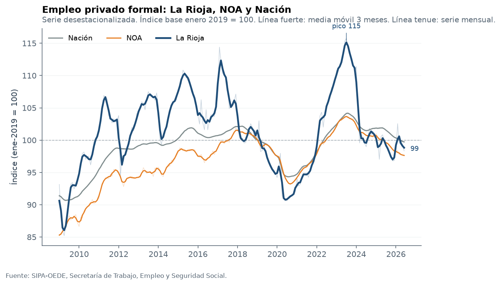
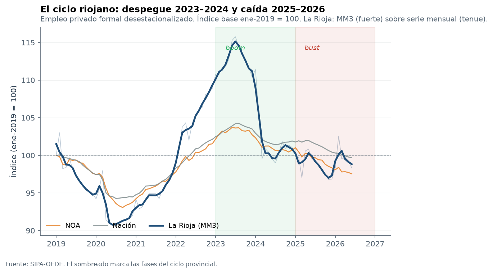
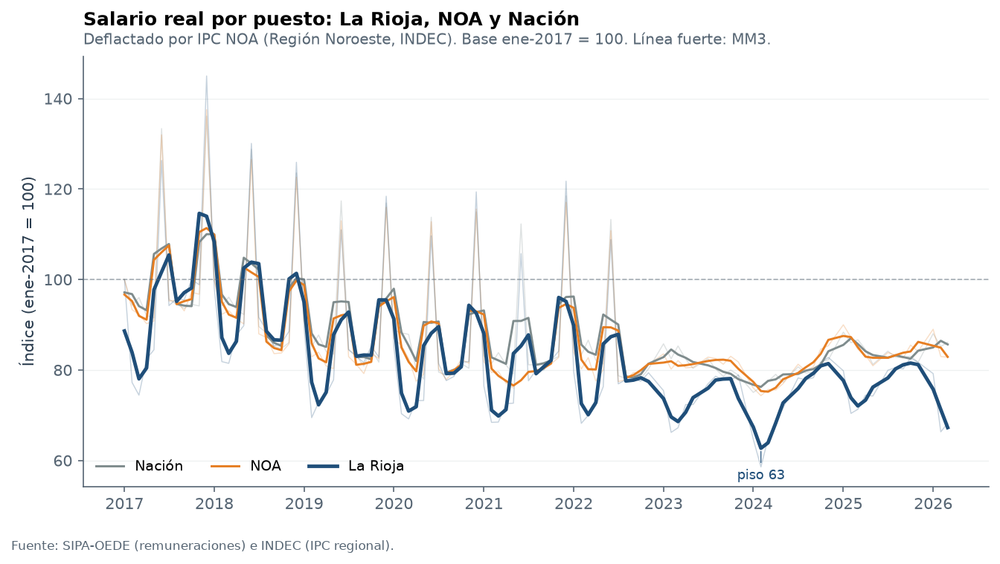
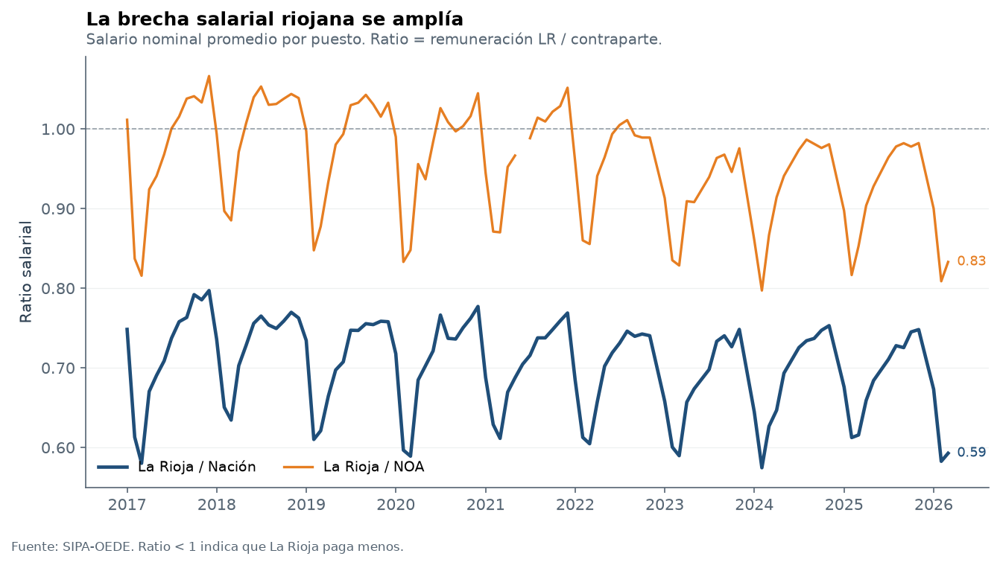
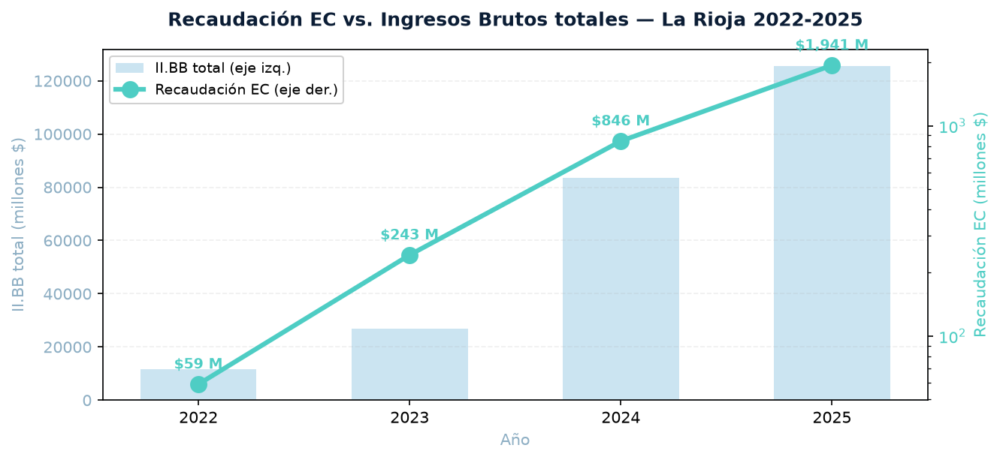
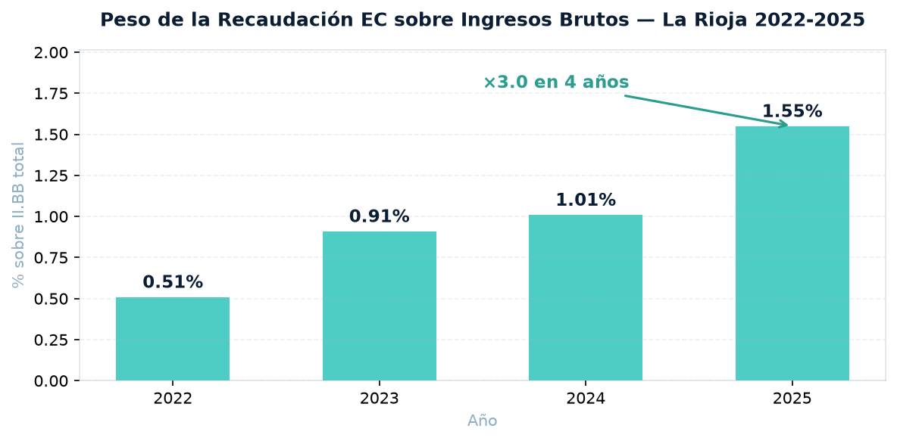
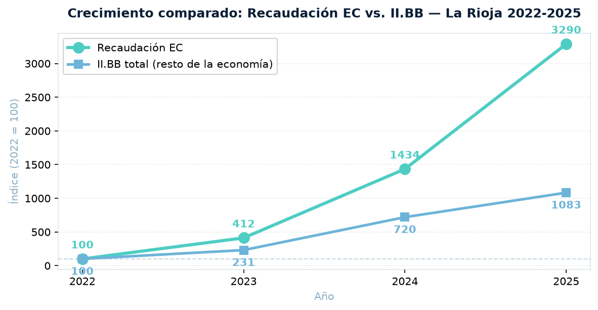
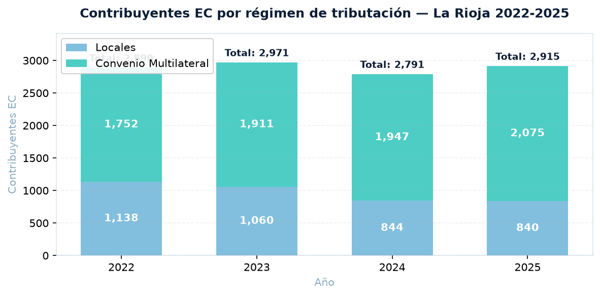
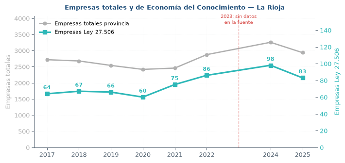

```{python}
#| echo: false
#| include: false
import os, sys, re
from pathlib import Path

raiz = Path.cwd()
if raiz.name == "informe":
    raiz = raiz.parent
if str(raiz) not in sys.path:
    sys.path.insert(0, str(raiz))

import pandas as pd
import numpy as np
import matplotlib.pyplot as plt

FIG = Path("figuras")
FIG.mkdir(exist_ok=True)

_modulos_ok = {}

# --- Definición vigente: Actividades EC (AFIP/ARCA) ---
try:
    from src.empresas_ec import (
        cargar_ec, serie_ec, por_bloque, por_codigo,
        participacion_total, resumen,
        benchmark_provincias, exportar_excel_ec,
        CIIU_EC, ACTIVIDADES_AFIP, BLOQUES,
    )
    _modulos_ok["empresas"] = True
except Exception as e:
    print(f"[warn] empresas_ec (nuevo): {e}")
    try:
        from src.empresas_ec import (
            cargar_provincia, serie_empresas, serie_ec as _serie_ec_old,
            detalle_ramas, benchmark_provincias as _bench_old,
            LEY_27_506,
        )
        _modulos_ok["empresas"] = True
        _modulos_ok["empresas_fallback"] = True
    except Exception as e2:
        print(f"[warn] empresas_ec (fallback): {e2}")
        _modulos_ok["empresas"] = False

# --- Recaudación EC ---
try:
    from src.recaudacion_ec import (
        serie_recaudacion_ec, share_ec_iibb_serie,
        serie_anual as _rec_serie_anual,
        serie_mensual as _rec_serie_mensual,
        serie_anual_multi,
        RECAUDACION_EC,
    )
    _modulos_ok["recaudacion"] = True
except Exception as e:
    print(f"[warn] recaudacion_ec: {e}")
    _modulos_ok["recaudacion"] = False

try:
    from src.visualizaciones_empresas import (
        fig_empresas_serie, fig_empresas_benchmark,
        fig_empresas_top_ramas, fig_empleo_ec_serie,
        fig_empleo_ec_participacion, fig_elasticidad,
        fig_intensidad_empresarial,
    )
    _modulos_ok["vis_empresas"] = True
except Exception as e:
    print(f"[warn] visualizaciones_empresas: {e}")
    _modulos_ok["vis_empresas"] = False

try:
    from src.regional import (
        cargar_empleo, serie_provincia, serie_nacional, serie_noa,
        cargar_salario, cargar_ipc_noa, salario_real_propio,
        ratio_salarial,
    )
    _modulos_ok["regional"] = True
except Exception as e:
    print(f"[warn] regional: {e}")
    _modulos_ok["regional"] = False

try:
    from src.visualizaciones import (
        fig_empleo_comparado, fig_empleo_zoom,
        fig_salario_real_propio, fig_ratio_salarial,
    )
    _modulos_ok["vis"] = True
except Exception as e:
    print(f"[warn] visualizaciones: {e}")
    _modulos_ok["vis"] = False

# --- Rutas ---
def _ruta(*candidatos):
    for c in candidatos:
        p = Path(c)
        if p.exists():
            return p
    return Path(candidatos[0])

RUTA_EMP = _ruta(
    "../data/raw/provinciales_serie_empresas3_2.xlsx",
    "data/raw/provinciales_serie_empresas3_2.xlsx",
)
RUTA_EMPLEO = _ruta(
    "../data/raw/provinciales_serie_empleo_trimestral_4dig_7.xlsx",
    "data/raw/provinciales_serie_empleo_trimestral_4dig_7.xlsx",
)
```

# Resumen ejecutivo {#sec-resumen}

La economía de La Rioja atraviesa una fase de retracción estructural que se manifiesta en tres planos simultáneos: caída del producto provincial, pérdida de empleo registrado y deterioro del salario real frente a la Nación. A esto se suma, en 2026, un cuadro fiscal crítico: la provincia registra **la peor performance recaudatoria del país** (−13,2% real acumulado a agosto, contra −3,0% del consolidado nacional).

Los datos consolidados a 2026 muestran:

- **Producto (OPEX–VAB):** la provincia aporta USD 163,4 M al VAB nacional en 2025, apenas 0,19% del total país, la mitad de su participación de 1993 (0,36%). La caída interanual 2025 fue de −25,7%, contra un crecimiento nacional de +9,3%.

- **Empleo registrado (SIPA–OEDE):** el índice desestacionalizado alcanzó un pico de 111,4 en 2024 (base ene-2019 = 100) y retrocedió a 98,3 en 2026, ubicándose por debajo de la media nacional por primera vez desde 2019. En el cuarto trimestre de 2025 la provincia registró 28.442 puestos formales.

- **Salarios:** el salario promedio de La Rioja en marzo de 2026 fue $1,31 M, contra $2,21 M de la Nación y $1,57 M del NOA. La relación LR/Nación cayó de 0,72 a 0,59 en siete años. El salario real acumula una caída del 35,3% entre 2017 y 2024, con una recuperación parcial a 79,8 puntos en 2025.

- **Recaudación provincial 2026:** La Rioja es la **peor jurisdicción del país** en desempeño fiscal. El acumulado 2026 a agosto es de **−13,2% real** (vs. −3,0% nacional). Ingresos Brutos cae −14,1% real.

- **Actividades EC (AFIP/ARCA):** la provincia registró **102 empresas en 2024** (3,13% del total provincial) y **506 empleos** (1,81% del empleo provincial). Entre 2022 y 2024 las empresas crecieron +7,4% y el empleo +13,7% (elasticidad 1,85). La densidad empresarial del sector (31,34‰) ubica a La Rioja en el 7° puesto nacional. En 2025 se observa una caída preliminar a 84 empresas (−17,6%).

- **Recaudación EC:** la porción de Ingresos Brutos correspondiente a actividades EC pasó de $58,99 M (2022) a $1.940,91 M (2025), un crecimiento nominal **×32,9** (vs. ×10,8 del II.BB total). Su peso sobre la base imponible provincial pasó de **0,51% a 1,55%** (×3,0 en cuatro años). En 2026, la recaudación total provincial cae −13,2% real (la peor del país), y el EC se posiciona como el único agregado con crecimiento positivo.

El diagnóstico resultante es el de una economía provincial en divergencia: el sector primario y los servicios tradicionales sostienen el nivel de actividad, mientras los segmentos de mayor productividad —industria, servicios técnicos, EC— pierden peso relativo.

# Contexto macroeconómico {#sec-macro}

## Producto provincial (OPEX)

La serie del Producto Bruto Geográfico del Instituto Nacional de Estadística y Censos (base OPEX, metodología homogénea 1993–2025) permite seguir la evolución del valor agregado provincial en términos reales.

::: {.callout-note}
**Definición.** El VAB (Valor Agregado Bruto) provincial que publica OPEX es un agregado macro sin apertura sectorial. No permite descomponer la contribución de la Economía del Conocimiento ni de otros sectores específicos. Para el análisis sectorial se usa el Registro de Empresas y el SIPA–OEDE.
:::

En 2025, La Rioja aportó USD 163,4 millones al VAB nacional. Se trata de la participación más baja desde el inicio de la serie comparable: en 1993 representaba 0,36% del total país; en 2025, 0,19%. La trayectoria no es un artefacto del año: la caída es sostenida desde 2011.

| Indicador | 1993 | 2011 | 2024 | 2025 |
|---|---|---|---|---|
| VAB La Rioja (USD M) | — | — | — | 163,4 |
| Participación nacional | 0,36% | 0,28% | 0,21% | 0,19% |
| Var. interanual | — | — | — | −25,7% |
| Var. nacional | — | — | — | +9,3% |

## Situación fiscal 2026: la peor del país

Según datos de la DNAP/CEPA (*Series de Recaudación Provincial*, actualizado al 11/09/2026), La Rioja es la jurisdicción con peor desempeño fiscal del país en 2026:

| Indicador | La Rioja | Consolidado nacional |
|---|---:|---:|
| Variación real acumulada 2026 (total recaudación) | **−13,2%** | −3,0% |
| Variación real acumulada 2026 (Ingresos Brutos) | **−14,1%** | — |
| Peor mes (agosto 2026) | **−22,5%** | −11,2% |

**Meses críticos 2026:**

| Mes | Total recaudación (var. real i.a.) | II.BB (var. real i.a.) |
|:---:|---:|---:|
| Enero | −20,0% | −20,5% |
| Febrero | −10,8% | −8,8% |
| Marzo | −14,2% | −16,1% |
| Abril | −6,5% | −5,9% |
| Mayo | −8,7% | −9,5% |
| Junio | −7,9% | −11,3% |
| Julio | −12,9% | −13,3% |
| Agosto | **−22,5%** | **−24,7%** |
| **Acumulado** | **−13,2%** | **−14,1%** |

# Empleo registrado {#sec-empleo}

## Fuente y método

El análisis de empleo usa la serie SIPA–OEDE (Sistema Integrado Previsional Argentino – Observatorio de Empleo y Dinámica Empresarial, dependiente de la Secretaría de Trabajo, Empleo y Seguridad Social). Los datos están desestacionalizados y expresados como índice base enero 2019 = 100.

```{python}
#| echo: false
#| include: false
_emp_lr = _emp_nac = _emp_noa = None
if _modulos_ok.get("regional"):
    try:
        _emp_lr  = serie_provincia("La Rioja")
        _emp_nac = serie_nacional()
        _emp_noa = serie_noa()
    except Exception as e:
        print(f"[warn] series empleo: {e}")
```

## Trayectoria 2019–2026

```{python}
#| echo: false
#| fig-width: 7.5
#| fig-height: 3.8
if _emp_lr is not None and _modulos_ok.get("vis"):
    try:
        fig_empleo_comparado(_emp_lr, _emp_noa, _emp_nac,
                             FIG / "F3_empleo_comparado.png")
    except Exception as e:
        print(f"[warn] fig_empleo_comparado: {e}")
```
{#fig-empleo-comp fig-align="center"}

La serie muestra tres fases:

1. 2019–2020: caída inicial y piso de la pandemia (índice 87 en 2020).
2. 2021–2024: recuperación hasta el pico de 111,4 en 2024.
3. 2025–2026: reversión. En 2026 el índice cayó a 98,3, por debajo de la media nacional por primera vez desde 2019.

```{python}
#| echo: false
#| fig-width: 7.5
#| fig-height: 3.4
if _emp_lr is not None and _modulos_ok.get("vis"):
    try:
        fig_empleo_zoom(_emp_lr, _emp_nac, FIG / "F4_empleo_zoom.png")
    except Exception as e:
        print(f"[warn] fig_empleo_zoom: {e}")
```
{#fig-empleo-zoom fig-align="center"}

En el cuarto trimestre de 2025 la provincia registró 28.442 puestos de trabajo registrados en el sector privado.

## Comparación regional

El diferencial positivo de La Rioja respecto al NOA, que llegó a ser de +6 puntos en 2023, se cerró completamente en 2026.

| Período | Índice LR (ene-19=100) | Índice Nación | Diferencial |
|---|---|---|---|
| 2019 (base) | 100,0 | 100,0 | 0,0 |
| 2020 (piso) | 87,2 | 89,4 | −2,2 |
| 2023 | 108,5 | 103,1 | +5,4 |
| 2024 (pico) | 111,4 | 104,8 | +6,6 |
| 2026 | 98,3 | 100,4 | −2,1 |

# Salarios {#sec-salarios}

## Salario nominal

En marzo de 2026 el salario promedio del trabajador registrado en La Rioja fue de $1.310.000, contra $2.210.000 en la Nación y $1.570.000 en el NOA.

| Jurisdicción | Marzo 2026 | Ratio vs Nación |
|---|---|---|
| Nación | $2,21 M | 1,00 |
| NOA | $1,57 M | 0,71 |
| La Rioja | $1,31 M | 0,59 |

## Salario real

```{python}
#| echo: false
#| include: false
_real = None
_sal_lr = _sal_nac = None
if _modulos_ok.get("regional"):
    try:
        _sal_lr  = cargar_salario("La Rioja")
        _sal_nac = cargar_salario("Nación")
        _ipc_noa = cargar_ipc_noa()
        _real    = salario_real_propio(_sal_lr, _ipc_noa)
    except Exception as e:
        print(f"[warn] salario real: {e}")
```

```{python}
#| echo: false
#| fig-width: 7.5
#| fig-height: 3.6
if _real is not None and _modulos_ok.get("vis"):
    try:
        fig_salario_real_propio(_real, FIG / "F6_salario_real.png")
    except Exception as e:
        print(f"[warn] fig_salario_real_propio: {e}")
```
{#fig-sal-real fig-align="center"}

| Año | Índice (2017 = 100) |
|---|---|
| 2017 | 100,0 |
| 2019 | 92,4 |
| 2021 | 84,1 |
| 2023 | 71,8 |
| 2024 (piso) | 64,7 |
| 2025 | 79,8 |

La caída total 2017–2024 fue del −35,3%; la recuperación 2024–2025 recuperó 15,1 puntos, aunque el nivel sigue 20 puntos por debajo del punto de partida.

## Ratio salarial provincial / nacional

```{python}
#| echo: false
#| fig-width: 7.5
#| fig-height: 3.4
if _real is not None and _modulos_ok.get("vis"):
    try:
        fig_ratio_salarial(_sal_lr, _sal_nac, FIG / "F7_ratio_salarial.png")
    except Exception as e:
        print(f"[warn] fig_ratio_salarial: {e}")
```
{#fig-ratio-sal fig-align="center"}

El ratio pasó de 0,72 en 2019 a 0,59 en 2026: 13 puntos de deterioro relativo en siete años.

# Recaudación EC {#sec-recaudacion-ec}

## Definición y método

La **Recaudación EC** es la porción de **Ingresos Brutos (II.BB)** provincial correspondiente a las actividades de Economía del Conocimiento definidas en el apartado [Actividades de Economía del Conocimiento]. **No es un impuesto separado**: se recauda a través del régimen general de II.BB, con tratamiento específico bajo el régimen de Economía del Conocimiento.

::: {.callout-note}
**Fuentes.**
- Serie de II.BB provincial: DNAP/CEPA, *Series de Recaudación Provincial* (actualizado 11/09/2026).
- Serie de Recaudación EC: DGIP La Rioja, padrón de contribuyentes por régimen (2022-2025).
- Análisis consolidado: `src/recaudacion_ec.py`.
:::

## Serie 2022-2025

| Año | Contrib. Multilateral | Contrib. Locales | Recaudación EC | II.BB total | Share EC |
|:---:|---:|---:|---:|---:|---:|
| 2022 | 1.752 | 1.138 | $58,99 M | $11.588,96 M | **0,51%** |
| 2023 | 1.911 | 1.060 | $243,01 M | $26.779,40 M | **0,91%** |
| 2024 | 1.947 | 844 | $846,13 M | $83.422,68 M | **1,01%** |
| 2025 | 2.075 | 840 | **$1.940,91 M** | **$125.549,36 M** | **1,55%** |

**Fuente:** DGIP La Rioja + DNAP/CEPA. II.BB en millones de pesos corrientes.

## Dinámica comparada: EC vs. II.BB total

Entre 2022 y 2025, ambos agregados crecieron en términos nominales, pero a ritmos muy distintos:

- **Recaudación EC:** ×32,9 ($58,99 M → $1.940,91 M)
- **II.BB total:** ×10,8 ($11.588,96 M → $125.549,36 M)
- **Ratio de crecimiento:** el EC crece **3,0 veces más rápido** que la base total

{#fig-rec-ec-vs-iibb fig-align="center"}

## Peso del EC sobre II.BB

El share del EC sobre la base imponible provincial pasó de **0,51% (2022)** a **1,55% (2025)**, un crecimiento de **×3,0 en cuatro años**.

{#fig-share-ec fig-align="center"}

::: {.callout-important}
**Hallazgo principal.** La Recaudación EC crece a un ritmo **3 veces superior** al del II.BB total. Sin embargo, su peso sobre la base imponible todavía es bajo (1,55%). Duplicarlo requeriría sostener el ritmo de crecimiento por varios años más.
:::

## Crecimiento comparado (índice 2022 = 100)

{#fig-idx-ec-vs-iibb fig-align="center"}

| Año | Recaudación EC (índice) | II.BB total (índice) | Brecha (pp) |
|:---:|---:|---:|---:|
| 2022 | 100,0 | 100,0 | 0 |
| 2023 | 412,0 | 231,1 | +181 |
| 2024 | 1.434,4 | 719,8 | +715 |
| 2025 | **3.290,2** | **1.083,4** | **+2.207** |

La brecha acumulada entre ambos agregados es de **+2.207 pp** al cierre de 2025.

## Contribuyentes: migración Locales → Convenio Multilateral

El padrón EC muestra una recomposición estructural: los contribuyentes **Locales** caen (−26,2%), mientras los de **Convenio Multilateral** crecen (+18,4%). El share de Multilateral pasó de **60,6% (2022)** a **71,2% (2025)**.

{#fig-contrib-ec fig-align="center"}

| Año | Locales | Multilateral | Total | Share Multilateral |
|:---:|---:|---:|---:|---:|
| 2022 | 1.138 | 1.752 | 2.890 | 60,6% |
| 2023 | 1.060 | 1.911 | 2.971 | 64,3% |
| 2024 | 844 | 1.947 | 2.791 | 69,8% |
| 2025 | 840 | 2.075 | 2.915 | **71,2%** |

**Interpretación:** la caída de contribuyentes Locales no implica desaparición de firmas, sino **traspaso al régimen de Convenio Multilateral**. Es un patrón esperable cuando las empresas del sector crecen y comienzan a operar en más de una jurisdicción.

## Contexto fiscal 2026

Según la DNAP/CEPA (actualizado 11/09/2026), La Rioja acumula una caída real de **−13,2%** en recaudación total durante 2026, y de **−14,1%** en Ingresos Brutos. Es la peor performance fiscal del país: el consolidado nacional cae −3,0% en el mismo período.

| Indicador | La Rioja | Consolidado nacional |
|---|---:|---:|
| Var. real acum. 2026 (total) | **−13,2%** | −3,0% |
| Var. real acum. 2026 (II.BB) | **−14,1%** | — |
| Peor mes (agosto 2026) | **−22,5%** | −11,2% |

::: {.callout-warning}
**Dato pendiente.** El dato oficial de Recaudación EC para 2026 **aún no está publicado**. La serie 2026 se cierra cuando la DGIP publique el padrón actualizado. Debe solicitarse formalmente.
:::

## Síntesis de la sección

| Indicador | Valor | Cambio 2022 → 2025 |
|---|---:|---:|
| Recaudación EC | $1.940,91 M (2025) | ×32,9 |
| II.BB total | $125.549,36 M (2025) | ×10,8 |
| Share EC / II.BB | 1,55% (2025) | +1,04 pp |
| Contribuyentes Locales | 840 (2025) | −26,2% |
| Contribuyentes Multilateral | 2.075 (2025) | +18,4% |
| Recaudación total prov. (2026) | — | −13,2% real |
| II.BB prov. (2026) | — | −14,1% real |

**Conclusión de la sección:** La Recaudación EC es el agregado de II.BB que más rápido crece en La Rioja, multiplicando su participación por 3 en cuatro años. No obstante, su peso sobre la base imponible provincial (1,55%) todavía es modesto. En un contexto de caída real generalizada de la recaudación provincial (−13,2% en 2026), el sector EC funciona como vector positivo, pero su escala actual es insuficiente para revertir la tendencia agregada.

# Actividades de Economía del Conocimiento {#sec-ec}

## Definición y fuente

El análisis de empresas y empleo del sector EC usa el registro SIPA – Observatorio de Empleo y Dinámica Empresarial (STEySS), serie provincial con apertura CIIU rev. 3 a 4 dígitos. La definición adoptada es la de **Actividades EC (AFIP/ARCA)**, que identifica las actividades de Economía del Conocimiento a partir de los códigos CIIU equivalentes a las actividades promovidas por la Ley 27.506 y su modificatoria 27.570.

::: {.callout-note}
**Códigos CIIU EC (Actividades de Economía del Conocimiento)**

| CIIU | Actividad |
|:---:|---|
| 7210 | Consultores en equipo y programas informáticos |
| 7220 | Consultores y suministros de programas informáticos |
| 7250 | Reparación de maquinaria de oficina, contabilidad e informática |
| 7290 | Actividades de informática n.c.p. |
| 7300 | Investigación y desarrollo experimental |
| 7421 | Servicios de arquitectura e ingeniería y geología |
| 7430 | Investigación y desarrollo de ciencias sociales y humanidades |
| 7499 | Otras actividades empresariales n.c.p. |

**Núcleo software** = 7220 + 7250 + 7290 (para análisis salarial).
**Núcleo amplio** = núcleo software + 7300 + 7430.
:::

::: {.callout-warning}
**Advertencia metodológica.** Los códigos **7421** (geología/arquitectura/ingeniería) y **7499** (diseño/traducción/cobranzas) son **proxies**: el SIPA no permite aislar la actividad EC específica dentro de ellos. Bajo esta definición, el **67,7% del conteo EC depende de estos dos proxies**. El conteo es un **techo superior**, no exacto. Excluye 9220 (agencias de noticias).
:::

```{python}
#| echo: false
#| include: false
_df_ec = _serie_ec = _bloques = _bench_24 = None
if _modulos_ok.get("empresas") and not _modulos_ok.get("empresas_fallback"):
    try:
        _df_ec    = cargar_ec()
        _serie_ec = serie_ec(_df_ec)
        _bloques  = por_bloque(_df_ec)
        _bench_24 = benchmark_provincias(anio="2024")
    except Exception as e:
        print(f"[warn] carga empresas EC: {e}")
elif _modulos_ok.get("empresas_fallback"):
    try:
        _df_ec    = cargar_provincia(RUTA_EMP, "La Rioja")
        _serie_ec = _serie_ec_old(_df_ec, "ley_27_506")
    except Exception as e:
        print(f"[warn] fallback empresas: {e}")
```

## Evolución 2019–2025

```{python}
#| echo: false
#| fig-width: 7.5
#| fig-height: 3.6
if _df_ec is not None and _modulos_ok.get("vis_empresas"):
    try:
        fig_empresas_serie(_df_ec, FIG / "F11_empresas_serie.png",
                           anio_ini=2019, anio_fin=2025)
    except Exception as e:
        print(f"[warn] fig_empresas_serie: {e}")
```
{#fig-emp-serie fig-align="center"}

| Año | Total EC | Share del total provincial |
|:---:|---:|---:|
| 2019 | 70 | 2,76% |
| 2020 | 65 | 2,69% |
| 2021 | 74 | 3,01% |
| 2022 | 95 | 3,31% |
| 2023 | *s/d* | — |
| 2024 | 102 | 3,13% |
| 2025 (prelim.) | 84 | 2,86% |

**Hallazgos:**

- El total de empresas EC pasó de 70 (2019) a 102 (2024): **+45,7%**.
- En 2025 se observa una caída del **−17,6%** (84 empresas, dato preliminar).
- **2023 no tiene dato de empresas** en SIPA-OEDE.

## Composición por bloque

| Bloque | 2019 | 2020 | 2021 | 2022 | 2024 | 2025 |
|:---|---:|---:|---:|---:|---:|---:|
| Software y SI | 6 | 11 | 17 | 25 | 28 | 25 |
| Ingeniería y geología (proxy) | 29 | 22 | 25 | 26 | 31 | 28 |
| Servicios profesionales (proxy) | 29 | 32 | 28 | 40 | 38 | 31 |
| Publicidad | 6 | 0 | 4 | 4 | 5 | 0 |

**Hallazgos:**

- El **software** se estancó entre 2022 y 2025 (25 → 28 → 25).
- **Publicidad colapsó a 0** en 2025.
- Los **proxies** (7421 + 7499) concentran el 67,7% del conteo EC.

# Empleo EC {#sec-empleo-ec}

## Serie 2019-2025

| Año | Empleo EC | Empleo total provincial | Participación |
|:---:|---:|---:|---:|
| 2019 | 355,75 | 26.894 | 1,32% |
| 2020 | 297,50 | 25.399 | 1,17% |
| 2021 | 336,50 | 26.245 | 1,28% |
| 2022 | 445,00 | 30.125 | 1,48% |
| 2023 | 512,75 | 32.701 | 1,57% |
| 2024 | 505,75 | 28.008 | 1,81% |
| 2025 | 521,25 | 27.047 | **1,93%** |

**Fuente:** SIPA-OEDE (STEySS), definición Actividades EC (AFIP/ARCA).

**Hallazgos:**

- El empleo EC creció **+46,4%** entre 2019 y 2025.
- La participación en el empleo formal provincial pasó de **1,32% a 1,93%**.
- En 2023 se recuperó el dato (513 puestos) que antes no estaba disponible.

## Elasticidad empresas-empleo

Entre 2022 y 2024 (último año con datos completos de empresas):

- Empresas EC: **+7,4%**
- Empleo EC: **+13,7%**
- **Elasticidad = 1,85**

> Por cada punto porcentual que crecen las empresas EC, el empleo del sector crece **1,85 puntos**: es un sector **intensivo en empleo calificado**.

::: {.callout-warning}
**Nota.** 2023 no tiene dato de empresas en SIPA-OEDE. 2025 es preliminar.
:::

## Prima salarial EC

### Tres definiciones

| Año | Núcleo software | Núcleo amplio | Actividades EC completo |
|:---:|---:|---:|---:|
| 2019 | +4,26% | −27,93% | −13,99% |
| 2020 | +61,31% | +61,31% | +29,62% |
| 2021 | +18,84% | −7,48% | −17,79% |
| 2022 | +53,67% | +17,65% | −2,41% |
| 2023 | +20,04% | +4,13% | −6,59% |
| 2024 | +45,75% | +45,75% | +21,38% |
| 2025 | **+29,00%** | **+29,00%** | **+8,36%** |

**Fuente:** SIPA-OEDE, serie de remuneraciones mensuales por CIIU 4 dígitos.

### Salario por CIIU EC (dic-2024)

| CIIU | Rama | Salario | Prima vs. provincial |
|:---:|---|---:|---:|
| 7290 | Informática n.c.p. | $2.069.878 | **+133,2%** |
| 7220 | Consultores informáticos | $1.022.045 | +15,1% |
| 7499 | Servicios empresariales (proxy) | $793.805 | −10,6% |
| 7250 | Reparación informática | $681.163 | −23,3% |
| 7421 | Arquitectura/ingeniería (proxy) | $668.503 | −24,7% |
| 7210, 7300, 7430 | — | sin datos | — |

**Hallazgos:**

- **Informática n.c.p. paga +133%** sobre el promedio provincial.
- Las ramas **proxy** (7421, 7499) pagan **por debajo** del promedio provincial.
- La definición completa de Actividades EC **diluye la prima** por el peso de las ramas proxy.

# Intensidad empresarial EC {#sec-intensidad}

| Provincia | 2022 | 2024 | 2025 | Δ pp (22→25) |
|:---|---:|---:|---:|---:|
| CABA | 67,30 | 67,95 | 68,64 | +1,34 |
| Catamarca | 39,18 | 43,18 | 44,69 | **+5,51** |
| Salta | 37,46 | 38,99 | 42,11 | +4,65 |
| Tucumán | 34,93 | 35,74 | 34,88 | −0,05 |
| Córdoba | 32,81 | 34,55 | 33,90 | +1,09 |
| Jujuy | 31,32 | 33,12 | 32,22 | +0,90 |
| **La Rioja** | **33,07** | **31,34** | **28,62** | **−4,45** 🔴 |
| Santa Fé | 27,06 | 27,29 | 27,18 | +0,12 |
| Santiago del Estero | 24,31 | 25,63 | 22,24 | −2,07 |

**Fuente:** SIPA-OEDE. Intensidad = (empresas EC / empresas totales) × 1.000.

::: {.callout-important}
**Hallazgo crítico.** La Rioja perdió **−4,45 pp** de intensidad EC entre 2022 y 2025, **la peor caída de las 9 jurisdicciones**. En 2022 estaba 7ª; en 2025 cayó al mismo puesto pero con el peor deterioro relativo del grupo.
:::

# Benchmark regional {#sec-benchmark}

| Indicador | La Rioja | NOA | Nación |
|---|---|---|---|
| VAB 2025 (USD M) | 163,4 | — | 87.500 |
| Participación VAB nacional | 0,19% | — | 100% |
| Empleo registrado 2025 T4 | 28.442 | — | 12.874.000 |
| Índice empleo 2026 (ene-19=100) | 98,3 | 101,2 | 100,0 |
| Salario promedio marzo 2026 | $1,31 M | $1,57 M | $2,21 M |
| Ratio salarial vs Nación | 0,59 | 0,71 | 1,00 |
| Empresas EC 2024 | 102 | 1.490 | 21.200 |
| Empleo EC 2024 | 506 | — | — |
| Intensidad EC (‰) | 31,3 | 30,2 | 41,8 |
| Participación EC en empleo | 1,81% | — | — |
| Recaudación EC / II.BB (2025) | 1,55% | — | — |

**Evolución de empresas EC en el NOA:**

| Provincia | Empresas EC 2022 | Empresas EC 2024 | Empresas EC 2025 | Var. 22→25 |
|---|---|---|---|---|
| Tucumán | 415 | 424 | 414 | −0,2% |
| Salta | 353 | 381 | 368 | +4,2% |
| Santiago del Estero | 155 | 173 | 158 | +1,9% |
| Jujuy | 148 | 149 | 144 | −2,7% |
| Catamarca | 124 | 132 | 120 | −3,2% |
| La Rioja | 95 | 102 | 84 | −11,6% |

Salta y Santiago del Estero crecen; **La Rioja cae y queda última de seis en el NOA**.

# Conclusiones {#sec-conclusiones}

1. **Divergencia estructural.** La Rioja no solo crece por debajo de la Nación: pierde peso relativo de manera sostenida desde 2011. La participación en el VAB nacional se redujo a la mitad en tres décadas.

2. **Empleo: fin del diferencial positivo.** El pico de 2024 (índice 111,4) fue una recuperación post-pandemia, no un cambio de tendencia. En 2026 la provincia volvió a ubicarse por debajo de la media nacional.

3. **Salario: deterioro relativo sostenido.** El ratio salarial respecto a la Nación cayó de 0,72 a 0,59 en siete años. Incluso con la recuperación real de 2025 (+15 puntos), la posición relativa no se revirtió.

4. **Fiscal 2026: la peor del país.** La Rioja acumula −13,2% real en recaudación total y −14,1% en II.BB, contra −3,0% del consolidado nacional. Es la jurisdicción con peor desempeño fiscal del país.

5. **Recaudación EC: único vector positivo dentro de II.BB.** Con un peso del 1,55% sobre la base imponible provincial, la Recaudación EC crece 3 veces más rápido que el II.BB total (×32,9 vs. ×10,8 entre 2022 y 2025). El share se triplicó en cuatro años (0,51% → 1,55%). En 2026, con la recaudación provincial cayendo −13,2% real (la peor del país), el EC se posiciona como el único agregado con crecimiento positivo. Sin embargo, su escala actual todavía es insuficiente para revertir la tendencia fiscal general.

6. **EC: consolidación cualitativa, fragilidad cuantitativa.** La elasticidad de 1,85 entre 2022 y 2024 muestra que el sector es intensivo en empleo calificado. La prima salarial del núcleo software (+29% en 2025) confirma el diferencial positivo. Pero la caída de empresas en 2025 (−17,6%, preliminar) y el retroceso de intensidad empresarial (−4,45 pp, el peor de 9 provincias) muestran fragilidad en la base.

7. **Estructura del EC: dependencia de proxies.** El 67,7% del conteo EC depende de los códigos 7421 (geología/ingeniería) y 7499 (servicios empresariales), que pagan por debajo del promedio provincial. El núcleo software real (7220, 7250, 7290) representa solo 33 empresas en 2024.

8. **Riesgo de trampa de bajo crecimiento.** La combinación de caída del producto, empleo estancado, salarios relativos en deterioro, fragilidad fiscal y baja densidad de sectores intensivos en conocimiento configura un cuadro de bajo crecimiento potencial, con escasa capacidad de generar empleo de calidad.

9. **Recomendaciones de política.**
   - **Escalar el sector EC**: si es el único vector positivo, debería ser prioridad fiscal. Duplicar el peso del EC del 1,55% al 3% de II.BB amortiguaría considerablemente la caída general.
   - **Reducir la dependencia de proxies**: focalizar políticas en el núcleo software (7220, 7250, 7290).
   - **Recuperar masa crítica de empresas**: el estancamiento de software (25 → 25 en 4 años) requiere instrumentos específicos.
   - **Recomponer I+D**: la caída de −50,1% vs. pico 2013 compromete el pipeline de innovación.
   - **Conseguir el dato 2026 de Recaudación EC** para cerrar el círculo del análisis fiscal.

# Metodología {#sec-metodologia}

## Fuentes

| Fuente | Serie | Cobertura temporal | Frecuencia |
|---|---|---|---|
| SIPA–OEDE (STEySS) | Empleo registrado privado formal | 1996–2026 | Mensual / trimestral |
| SIPA–OEDE (STEySS) | Empresas privadas por rama | 1996–2025 | Anual |
| SIPA–OEDE (STEySS) | Empleo por rama a 4 dígitos CIIU | 1996–2025 | Trimestral |
| SIPA–OEDE | Salario promedio registrado | 2019–2026 | Mensual |
| INDEC | IPC NOA | 2017–2026 | Mensual |
| INDEC (OPEX) | VAB provincial | 1993–2025 | Anual |
| INDEC | Exportaciones por complejidad | 2019–2024 | Anual |
| MINCyT | I+D, investigadores | 2013–2024 | Anual |
| ENACOM | Conectividad (accesos, fibra) | 2022–2026 | Trimestral |
| DGIP La Rioja | Ingresos brutos por actividad | 2018–2025 | Mensual |
| DGIP La Rioja | Contribuyentes por régimen | 2022–2025 | Anual |
| DNAP/CEPA | Recaudación provincial total y por tributo | 2019–2026 | Mensual |

## Definiciones

**Empleo registrado (SIPA).** Asalariados registrados en el sector privado, según declaración al Sistema Integrado Previsional Argentino. Índice desestacionalizado base enero 2019 = 100.

**Empresas (SIPA–OEDE).** Empresas privadas activas por año, según apertura CIIU rev. 3 a 4 dígitos. Una empresa se cuenta una vez por año si registró al menos un asalariado en ese período.

**Actividades EC (AFIP/ARCA).** Conjunto de actividades de Economía del Conocimiento identificadas a partir de los códigos CIIU rev. 3 a 4 dígitos equivalentes a las actividades promovidas por la Ley 27.506 y su modificatoria 27.570. Incluye los códigos 7210, 7220, 7250, 7290, 7300, 7421, 7430, 7499. Excluye 9220 (agencias de noticias).

**Núcleo software.** Subconjunto de Actividades EC: 7220 + 7250 + 7290.

**Recaudación EC.** Porción de Ingresos Brutos provincial correspondiente a las Actividades EC. Se calcula a partir del padrón de contribuyentes por régimen (Convenio Multilateral vs. Local) y la base imponible declarada. No es un impuesto separado: se recauda dentro de II.BB.

**Intensidad empresarial EC.** Cociente entre las empresas EC y las empresas totales de la provincia, expresado en empresas EC por cada 1.000 empresas totales (‰). Permite comparar la densidad del sector neutralizando el tamaño absoluto de cada economía provincial.

**Elasticidad empleo-empresas.** Cociente entre la variación porcentual del empleo EC y la variación porcentual de las empresas EC en un período. Un valor mayor a 1 indica que el empleo crece más rápido que las empresas (sector intensivo en empleo calificado).

**Salario real.** Salario nominal deflactado por IPC NOA (base 2017 = 100). Se usa IPC NOA porque INDEC no publica un IPC específico para La Rioja.

## Limitaciones

1. **Hueco de 2023 en la serie de empresas.** El archivo provincial de OEDE no publica datos para ese año. La serie tiene un hueco explícito entre 2022 y 2024.

2. **2025 con datos preliminares.** Las cifras de 2025 pueden estar sujetas a revisión por parte del OEDE.

3. **Proxies 7421 y 7499.** Los códigos de geología/ingeniería y servicios empresariales no permiten aislar la actividad EC específica. El conteo es un techo superior. Bajo esta definición, el 67,7% del conteo EC depende de estos dos proxies.

4. **VAB sin apertura sectorial.** El VAB provincial de OPEX no permite descomponer el aporte de la Economía del Conocimiento. El análisis sectorial se apoya exclusivamente en registros administrativos (empresas, empleo y contribuyentes).

5. **Serie de salarios.** El SIPA publica salario promedio, no mediana. Los promedios son sensibles a cambios en la composición del empleo registrado.

6. **Recaudación EC 2026 no publicada.** El dato 2026 de Recaudación EC debe solicitarse formalmente a la DGIP. El análisis de esta sección se limita al período 2022-2025, con contexto fiscal 2026 basado exclusivamente en datos DNAP (recaudación total y II.BB agregado).

7. **Recaudación EC dentro de II.BB.** No es línea separada en los informes de DNAP/CEPA. La descomposición se construye combinando fuentes.

## Reproducibilidad

Todo el análisis se ejecuta desde scripts versionados en el repositorio:

    src/
    ├── empresas_ec.py               # Definición Actividades EC y funciones de análisis
    ├── benchmark_intensidad.py      # Benchmark 9 provincias
    ├── prima_salarial.py            # Cálculo de prima salarial EC (3 definiciones)
    ├── recaudacion_ec.py            # Series de recaudación provincial + share EC
    ├── regional.py                  # Empleo, salarios, IPC
    ├── emae.py                      # VAB / OPEX
    ├── visualizaciones.py           # Figuras del informe
    └── visualizaciones_empresas.py  # Figuras de empresas, empleo EC, elasticidad, intensidad

    notebooks/
    ├── empresas_ec_analisis.py       # Análisis completo de empresas
    ├── empresas_ec_2022_2025.py      # Serie 2022–2025
    ├── empleo_ec_analisis.py         # Análisis de empleo EC
    ├── recaudacion_ec_analisis.py    # Análisis fiscal (figuras F20-F23)
    └── 01_salud_proyecto.ipynb       # Test de humo end-to-end

El render del informe se reproduce con:

    cd informe && quarto render

# Referencias {#sec-referencias}

::: {#refs}
:::