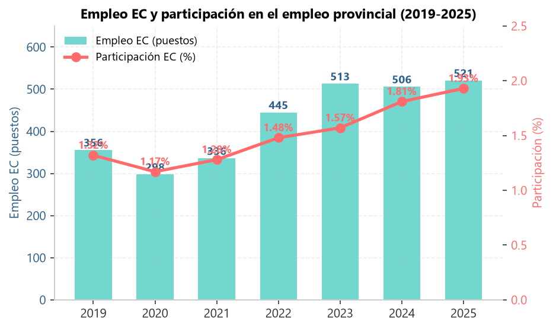
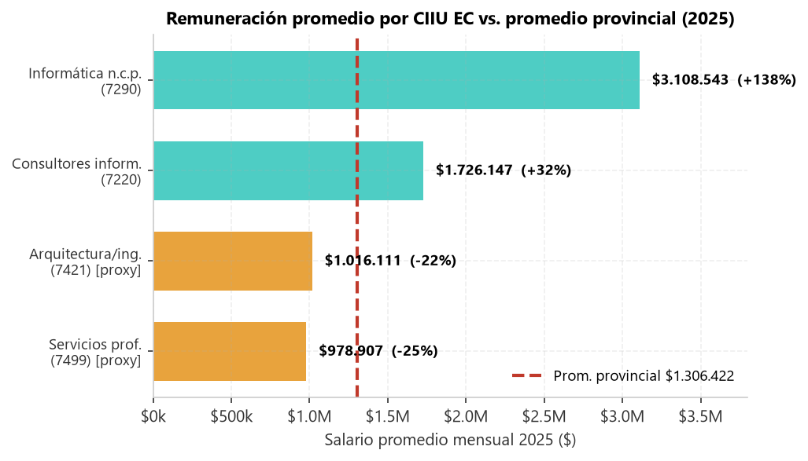
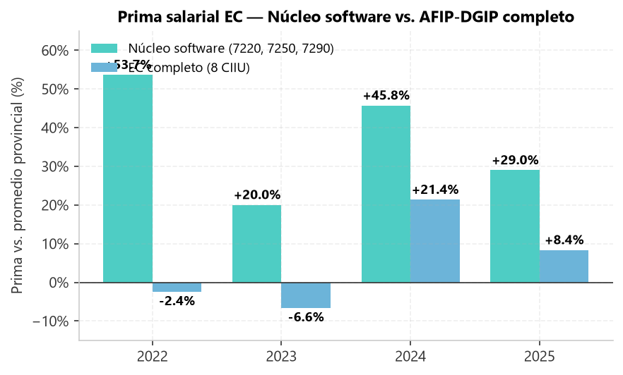
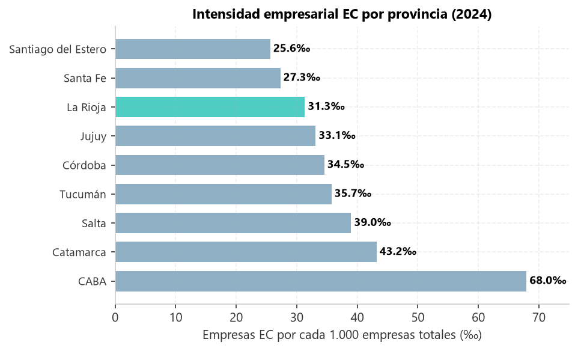
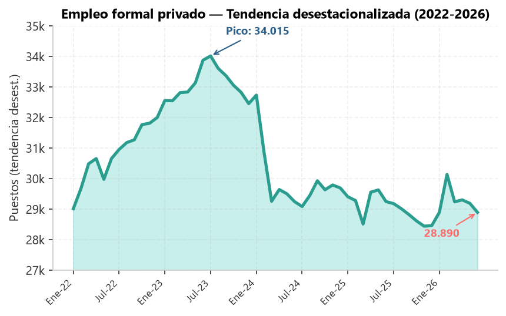

```{python}
#| echo: false
#| include: false
import sys
from pathlib import Path

raiz = Path.cwd()
if raiz.name == "informe":
    raiz = raiz.parent
if str(raiz) not in sys.path:
    sys.path.insert(0, str(raiz))

import pandas as pd
import numpy as np
import matplotlib.pyplot as plt
import matplotlib.ticker as mtick
from matplotlib.patches import Patch

FIG = Path("figuras")
FIG.mkdir(exist_ok=True)

plt.rcParams.update({
    "font.family": "sans-serif",
    "font.size": 10,
    "axes.spines.top": False,
    "axes.spines.right": False,
    "axes.grid": True,
    "grid.alpha": 0.2,
    "grid.linestyle": "--",
    "savefig.dpi": 150,
    "savefig.bbox": "tight",
})
```

# Resumen ejecutivo {#sec-resumen}

El empleo de la Economía del Conocimiento (EC) en La Rioja alcanzó **521 puestos en 2025**, equivalente al **1,93% del empleo formal privado provincial**. Sin embargo, de esos 521 puestos, solo **63,8 corresponden al núcleo software puro** (consultoría informática, desarrollo y reparación). El resto (457,6) son **proxies**: arquitectura, ingeniería y servicios empresariales.

Cinco hallazgos principales:

1. **Empleo EC: 521 puestos en 2025 (1,93% del total provincial).** Crecimiento de +46,4% respecto a 2019, pero con pico en 2023 (513) y meseta posterior.

2. **Núcleo software: solo 63,8 puestos (12,2% del EC).** El 87,8% restante son proxies que no son Economía del Conocimiento en sentido estricto.

3. **Prima salarial: +29,0% sobre el promedio provincial (2025).** El núcleo software paga consistentemente por encima del promedio, con picos de +53,7% (2022) y +45,8% (2024).

4. **El EC resiste mejor la recesión.** En 2025 el empleo EC creció +3,0% mientras el empleo provincial cayó −3,4%. La participación EC subió de 1,32% (2019) a 1,93% (2025).

5. **Peor desempeño federal en intensidad.** La Rioja perdió −4,45 pp de intensidad empresarial EC entre 2022 y 2025, la peor caída de 9 jurisdicciones comparadas.

**Diagnóstico general.** El empleo EC de La Rioja tiene un núcleo de alta calidad (los mejores salarios de la provincia) pero baja escala (63,8 puestos reales). El desafío no es crear el sector desde cero, sino escalar las firmas existentes y frenar la pérdida de masa crítica.

# Definición y metodología {#sec-definicion}

## Qué es la Economía del Conocimiento

La definición utilizada en este informe es la del **Régimen de Promoción de la Economía del Conocimiento**, creado por la **Ley 27.506 (2019)** y modificado por la **Ley 27.570 (2020)**. Esta ley identifica las actividades promovidas a partir de códigos de actividad de la **Agencia de Recaudación y Control Aduanero (ARCA)** — ex AFIP — y establece beneficios fiscales para las empresas del sector.

::: {.callout-note}
**Actualización normativa.** A partir de octubre de 2024, la AFIP fue disuelta y reemplazada por ARCA (Decreto 953/2024). ARCA es su continuadora jurídica. La definición del sector EC sigue rigiéndose por la Ley 27.506, sin cambios.
:::

## Los 8 códigos CIIU utilizados

Para poder cruzar la definición legal con las estadísticas provinciales disponibles, se tradujeron los códigos ARCA a los códigos **CIIU rev. 3** (Clasificador Industrial Internacional Uniforme) que usa el SIPA-OEDE.

| CIIU | Rama | Tipo | Datos en La Rioja |
|:---:|---|---|:---:|
| 7210 | Consultores en equipo de informática | Núcleo | s/d |
| 7220 | Consultores en informática y suministro de programas | Núcleo SW | ✅ |
| 7250 | Mantenimiento y reparación de maq. oficina/informática | Núcleo SW | ✅ |
| 7290 | Actividades de informática n.c.p. | Núcleo SW | ✅ |
| 7300 | Investigación y desarrollo | Núcleo amplio | s/d |
| 7421 | Arquitectura e ingeniería | Proxy | ✅ |
| 7430 | Servicios de publicidad | Núcleo amplio | s/d |
| 7499 | Servicios empresariales n.c.p. | Proxy | ✅ |

**Tipos**:
- **Núcleo software** (7220 + 7250 + 7290): definición canónica para análisis de empleo calificado.
- **Núcleo amplio** (+ 7300 + 7430): agrega I+D y publicidad.
- **Proxies** (7421 + 7499): agrupan actividades que van más allá de la EC estricta.

::: {.callout-warning}
**Advertencia metodológica.** Los códigos **7421** (arquitectura, ingeniería, geología) y **7499** (servicios empresariales: diseño, traducción, cobranzas) son **proxies**: el SIPA no permite aislar la actividad EC específica dentro de ellos. Bajo la definición amplia, el **87,8% del empleo EC depende de estos dos códigos**. El conteo es un **techo superior**, no un número exacto.
:::

## Fuente de datos

| Concepto | Detalle |
|---|---|
| **Organismo** | SIPA-OEDE (Observatorio de Empleo y Dinámica Empresarial) |
| **Dependencia** | Secretaría de Trabajo, Empleo y Seguridad Social (STEySS) |
| **Sistema** | Sistema Integrado Previsional Argentino (SIPA) |
| **Archivo** | `provinciales_serie_empleo_trimestral_4dig_7.xlsx` |
| **Hoja** | "La Rioja" |
| **Cobertura** | 1° Trim 1996 – 4° Trim 2025 |
| **Unidad** | Puestos de trabajo (stock al cierre del trimestre) |

El SIPA es un **registro administrativo**: todas las empresas registradas presentan declaraciones juradas mensuales con su personal en relación de dependencia. No es una encuesta, por lo que tiene cobertura casi universal del empleo formal.

# Cuánto empleo EC hay {#sec-cuanto}

## Serie histórica 2019-2025

{#fig-emp-share fig-align="center"}

| Año | Empleo EC (8 CIIU) | Empleo provincial total | Participación |
|:---:|---:|---:|---:|
| 2019 | 356 | 26.894 | 1,32% |
| 2020 | 298 | 25.399 | 1,17% |
| 2021 | 336 | 26.245 | 1,28% |
| 2022 | 445 | 30.125 | 1,48% |
| 2023 | 513 | 32.701 | 1,57% |
| 2024 | 506 | 28.008 | 1,81% |
| 2025 | **521** | **27.047** | **1,93%** |

**Fuente**: SIPA-OEDE (STEySS), CIIU 7210-7499.

El empleo EC pasó de **356** (2019) a **521** puestos (2025), un aumento de **+46,4%**. El pico se registró en **2023** con 513 puestos. Entre 2023 y 2025 el empleo EC creció solo **+1,6%**, mientras el empleo provincial caía **−17,3%**.

::: {.callout-important}
**Efecto composición.** La participación del EC en el empleo provincial subió de 1,32% a 1,93%. Pero ese aumento se explica, en parte, por la caída del denominador provincial (−17,3% entre 2023 y 2025), no solo por crecimiento del sector. En 2024-2025, sin embargo, el empleo EC creció +3,0% en términos absolutos, lo que sí es genuino.
:::

## Desglose 2025 por CIIU

| CIIU | Rama | T1 | T2 | T3 | T4 | **Promedio 2025** | Tipo |
|:---:|---|--:|--:|--:|--:|--:|:---:|
| 7220 | Consultores en informática | 27 | 27 | 28 | 25 | **26,8** | Núcleo SW |
| 7250 | Mantenimiento y reparación | 6 | 6 | 4 | 1 | **4,2** | Núcleo SW |
| 7290 | Informática n.c.p. | 29 | 32 | 36 | 34 | **32,8** | Núcleo SW |
| 7421 | Arquitectura e ingeniería | 172 | 225 | 217 | 197 | **202,8** | Proxy |
| 7499 | Servicios empresariales | 282 | 235 | 204 | 298 | **254,8** | Proxy |
| 7210 | Consultores equipo informática | s/d | s/d | s/d | s/d | **0** | Núcleo |
| 7300 | Investigación y desarrollo | s/d | s/d | s/d | s/d | **0** | Núcleo amplio |
| 7430 | Servicios de publicidad | s/d | s/d | s/d | s/d | **0** | Núcleo amplio |
| | **TOTAL** | | | | | **521,4** | |

**Fuente**: SIPA-OEDE (STEySS), hoja "La Rioja", promedio simple de los 4 trimestres de 2025.

**Los 5 códigos con datos** son 7220, 7250, 7290, 7421 y 7499. Los otros 3 no registran empleo asalariado privado en La Rioja.

## Núcleo software vs. proxies

{#fig-desglose fig-align="center"}

| Tipo | CIIU | Puestos 2025 | % del EC |
|---|---|--:|--:|
| **Núcleo software** | 7220 + 7250 + 7290 | **63,8** | **12,2%** |
| **Núcleo amplio** | 7210 + 7300 + 7430 | 0 | 0,0% |
| **Proxies** | 7421 + 7499 | **457,6** | **87,8%** |
| **TOTAL EC** | | **521,4** | **100%** |

**De cada 8 empleos contabilizados como "Economía del Conocimiento", solo 1 es realmente software puro.**

## Evolución del núcleo vs. proxies (2019-2025)

| Año | Núcleo SW | Proxies | Total EC | % Núcleo |
|:---:|--:|--:|--:|--:|
| 2019 | 11,5 | 344,5 | 356 | 3,2% |
| 2020 | 23,8 | 274,2 | 298 | 8,0% |
| 2021 | 29,0 | 307,0 | 336 | 8,6% |
| 2022 | 65,5 | 379,5 | 445 | 14,7% |
| 2023 | 78,0 | 435,0 | 513 | **15,2%** |
| 2024 | 61,3 | 444,7 | 506 | 12,1% |
| 2025 | 63,8 | 457,6 | 521 | 12,2% |

El núcleo software **nunca superó el 15,2% del total EC**. Entre 2023 y 2025 perdió 3 pp de participación: el sector se "proxificó".

# Cómo evolucionó el empleo EC {#sec-evolucion}

## Crecimiento 2019-2023

Entre 2019 y 2023, el empleo EC creció **+44,1%** (de 356 a 513 puestos). Ese crecimiento fue impulsado por:

- La recuperación post-pandemia (2021-2022).
- El crecimiento del bloque software, que pasó de 6 a 28 empresas.
- La expansión de consultores informáticos, que multiplicaron por 5 su participación en los ingresos del sector.

## La meseta 2024-2025

Entre 2023 y 2025, el empleo EC pasó de 513 a 521 puestos: **+1,6%**. El sector dejó de crecer.

**Dos interpretaciones posibles**:

- **Piso**: el sector tocó fondo y va a recuperarse.
- **Trampa**: el sector se estabilizó en un nivel bajo sin capacidad de recuperación.

La evidencia apunta a la segunda: la caída del empleo provincial (−17,3% en el mismo período) y la recesión macroeconómica no generan condiciones para la recuperación.

## Comparación con el empleo provincial

| Período | Empleo EC | Empleo provincial | Diferencia |
|:---:|--:|--:|--:|
| 2023-2025 | **+1,6%** | **−17,3%** | +18,9 pp |

**El EC resiste mejor la recesión.** En 2025, el empleo EC creció +3,0% mientras el empleo provincial cayó −3,4%. Es un sector con mayor productividad y menor sensibilidad al ciclo.

# Salarios y prima salarial {#sec-salarios}

## Salario por CIIU EC (promedio 2025)

{#fig-salarios fig-align="center"}

| CIIU | Rama | Salario promedio 2025 | Prima vs. provincial |
|:---:|---|---:|---:|
| 7290 | Informática n.c.p. | $3.108.543 | **+138%** |
| 7220 | Consultores informáticos | $1.726.147 | +32% |
| 7421 | Arquitectura/ingeniería (proxy) | $1.016.111 | −22% |
| 7499 | Servicios empresariales (proxy) | $978.907 | −25% |

**Fuente**: SIPA-OEDE, remuneraciones mensuales por CIIU 4 dígitos, promedio de los 12 meses de 2025. Salario provincial de referencia: $1.306.422.

**Hallazgo clave**: los dos códigos del núcleo software (7220, 7290) pagan **por encima** del promedio provincial. Los dos proxies (7421, 7499) pagan **por debajo**.

## Prima salarial del núcleo software (2022-2025)

{#fig-prima fig-align="center"}

| Año | Núcleo software | EC completo |
|:---:|---:|---:|
| 2022 | **+53,67%** | −2,41% |
| 2023 | **+20,04%** | −6,59% |
| 2024 | **+45,75%** | +21,38% |
| 2025 | **+29,00%** | +8,36% |

La prima del núcleo software se mantuvo **siempre positiva** en el período, con un promedio histórico de **+28,6%**.

**Frase clave**: un trabajador del núcleo software gana, en promedio, **un 29% más** que el trabajador promedio de La Rioja.

# Comparación federal {#sec-federal}

{#fig-intensidad fig-align="center"}

| Provincia | 2022 | 2024 | 2025 | Δ pp |
|:---|---:|---:|---:|---:|
| CABA | 67,30 | 67,95 | 68,64 | +1,34 |
| Catamarca | 39,18 | 43,18 | 44,69 | +5,51 |
| Salta | 37,46 | 38,99 | 42,11 | +4,65 |
| Tucumán | 34,93 | 35,74 | 34,88 | −0,05 |
| Córdoba | 32,81 | 34,55 | 33,90 | +1,09 |
| Jujuy | 31,32 | 33,12 | 32,22 | +0,90 |
| **La Rioja** | **33,07** | **31,34** | **28,62** | **−4,45** |
| Santa Fe | 27,06 | 27,29 | 27,18 | +0,12 |
| Santiago del Estero | 24,31 | 25,63 | 22,24 | −2,07 |

**Intensidad** = empresas EC por cada 1.000 empresas totales.

La Rioja está en el **7° puesto de 9**. Pero lo más importante es la **tendencia**: perdió **−4,45 pp** entre 2022 y 2025, la peor caída del grupo.

**Dato positivo**: La Rioja **supera a Santa Fe** (27,3‰), una provincia con una economía 15 veces más grande y con polo tecnológico consolidado.

# Coyuntura y contexto macro {#sec-coyuntura}

{#fig-coyuntura fig-align="center"}

El empleo privado formal de La Rioja atravesó **tres fases** entre 2022 y 2026:

1. **Auge (2022-2023)**: crecimiento post-pandemia, pico en **mayo 2023 (34.329 puestos)**.
2. **Caída (2024)**: derrumbe con variaciones i.a. de hasta **−14,5%**.
3. **Meseta (2025-2026)**: estabilización en torno a **29.000-30.000 puestos**, con i.a. cerca de cero.

En **mayo 2026** el stock fue de **30.305 puestos**, con una variación interanual de **−1,7%**. La caída acumulada desde el pico histórico (marzo 2017, 38.006) es de **−24,0%**.

**El sector EC resiste mejor que el promedio**: mientras el empleo provincial cae, el empleo EC crece o se mantiene.

# Conclusiones y recomendaciones {#sec-conclusiones}

## Conclusiones

1. **Empleo EC: 521 puestos (1,93% del provincial).** Crecimiento de +46,4% desde 2019, pero con pico en 2023 y meseta posterior.

2. **Núcleo software real: 63,8 puestos (12,2%).** El resto son proxies: arquitectura, ingeniería, servicios empresariales. El conteo de 521 es un techo superior.

3. **Prima salarial sostenida: +29,0% (2025).** El núcleo software paga consistentemente por encima del promedio provincial, con promedio histórico de +28,6%.

4. **El EC resiste mejor la recesión.** En 2025, empleo EC +3,0% vs. empleo provincial −3,4%.

5. **Peor desempeño federal en tendencia.** La Rioja perdió −4,45 pp de intensidad EC entre 2022 y 2025, la peor caída de 9 jurisdicciones.

## Recomendaciones de política

1. **Focalizar en el núcleo software** (7220, 7250, 7290). Son 63,8 puestos reales, no 521. La política pública debería concentrarse en esas actividades.

2. **Escalar las 28 empresas de software existentes.** Antes que crear nuevas firmas, apuntalar las que ya están. El bloque creció +367% desde 2019 pero cayó a 25 empresas en 2025.

3. **Generar talento local.** La prima del +29% indica escasez de informáticos calificados. Programas de formación específica pueden ampliar la oferta y sostener el diferencial.

4. **Aprovechar la ventana de conectividad.** La fibra óptica creció +188,7% en 4 años. Es el soporte físico para captar empleo remoto de empresas de otras provincias y del exterior.

5. **Frenar la caída de masa crítica.** El sector perdió −17,6% de empresas entre 2024 y 2025. Sin masa crítica, no hay ecosistema.

# Anexo A — Metodología {#sec-anexo}

## Cómo se calculó el 521

**Paso 1** — Se descargó el archivo `provinciales_serie_empleo_trimestral_4dig_7.xlsx` del SIPA-OEDE.

**Paso 2** — Se filtró la hoja "La Rioja".

**Paso 3** — Se seleccionaron los 8 códigos CIIU de la definición AFIP-DGIP (ahora ARCA-DGIP).

**Paso 4** — Para cada código, se tomaron los 4 trimestres de 2025.

**Paso 5** — Se calculó el promedio simple de los trimestres con dato disponible.

**Paso 6** — Se sumaron los 8 promedios para obtener el total EC 2025.

## Limitaciones

1. **Proxies 7421 y 7499**: agrupan arquitectura, ingeniería, geología, diseño, traducción, cobranzas. No son EC en sentido estricto.

2. **Sin datos en 7210, 7300, 7430**: no registran empleo asalariado privado en La Rioja.

3. **2025 preliminar**: los datos pueden ser revisados por OEDE.

4. **Salario promedio, no mediana**: sensible a cambios en composición.

5. **El 521 es un techo superior**: el núcleo real son 63,8 puestos.

# Anexo B — Siglas y enlaces {#sec-siglas}

## Siglas

| Sigla | Significado |
|---|---|
| **ARCA** | Agencia de Recaudación y Control Aduanero (ex AFIP) |
| **AFIP** | Administración Federal de Ingresos Públicos (disuelta 2024) |
| **CIIU** | Clasificador Industrial Internacional Uniforme (rev. 3) |
| **DGIP** | Dirección General de Ingresos Provinciales (La Rioja) |
| **EC** | Economía del Conocimiento |
| **II.BB.** | Ingresos Brutos |
| **INDEC** | Instituto Nacional de Estadística y Censos |
| **OEDE** | Observatorio de Empleo y Dinámica Empresarial |
| **SIPA** | Sistema Integrado Previsional Argentino |
| **STEySS** | Secretaría de Trabajo, Empleo y Seguridad Social |

## Enlaces a fuentes oficiales

| Fuente | Enlace |
|---|---|
| SIPA-OEDE (STEySS) | https://www.argentina.gob.ar/trabajo/estadisticas |
| Ley 27.506 (InfoLEG) | https://servicios.infoleg.gob.ar/infolegInternet/anexos/320000-324999/324101/texact.htm |
| Ley 27.570 (InfoLEG) | https://servicios.infoleg.gob.ar/infolegInternet/anexos/340000-344999/341816/norma.htm |
| Decreto 953/2024 (Boletín Oficial) | https://www.boletinoficial.gov.ar/ |
| ARCA (sitio oficial) | https://www.arca.gob.ar/ |
| DGIP La Rioja | https://www.dgip.larioja.gob.ar/ |
| INDEC | https://www.indec.gob.ar/ |

# Anexo C — Serie histórica completa {#sec-serie}

| Año | Núcleo SW | Proxies | Total EC | % Núcleo |
|:---:|--:|--:|--:|--:|
| 2019 | 11,5 | 344,5 | 356 | 3,2% |
| 2020 | 23,8 | 274,2 | 298 | 8,0% |
| 2021 | 29,0 | 307,0 | 336 | 8,6% |
| 2022 | 65,5 | 379,5 | 445 | 14,7% |
| 2023 | 78,0 | 435,0 | 513 | 15,2% |
| 2024 | 61,3 | 444,7 | 506 | 12,1% |
| 2025 | 63,8 | 457,6 | 521 | 12,2% |

**Fuente**: SIPA-OEDE (STEySS). Elaboración propia.